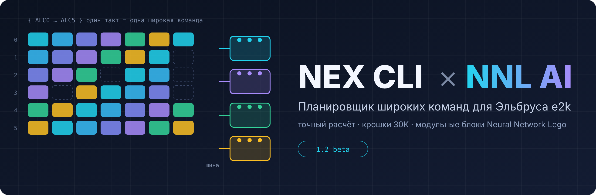
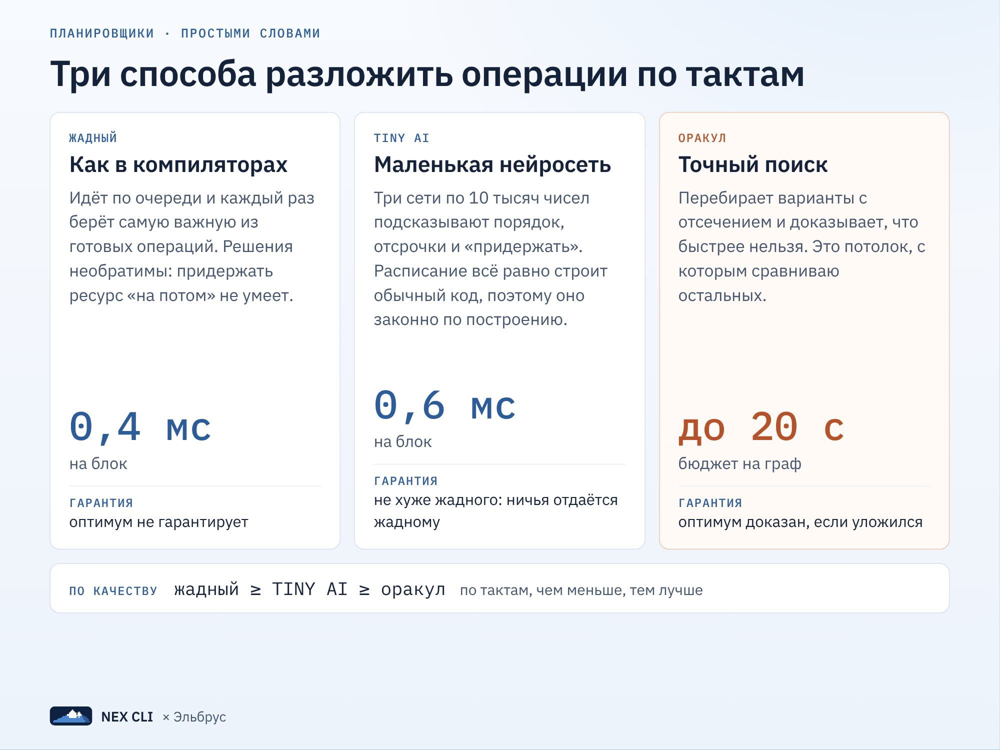
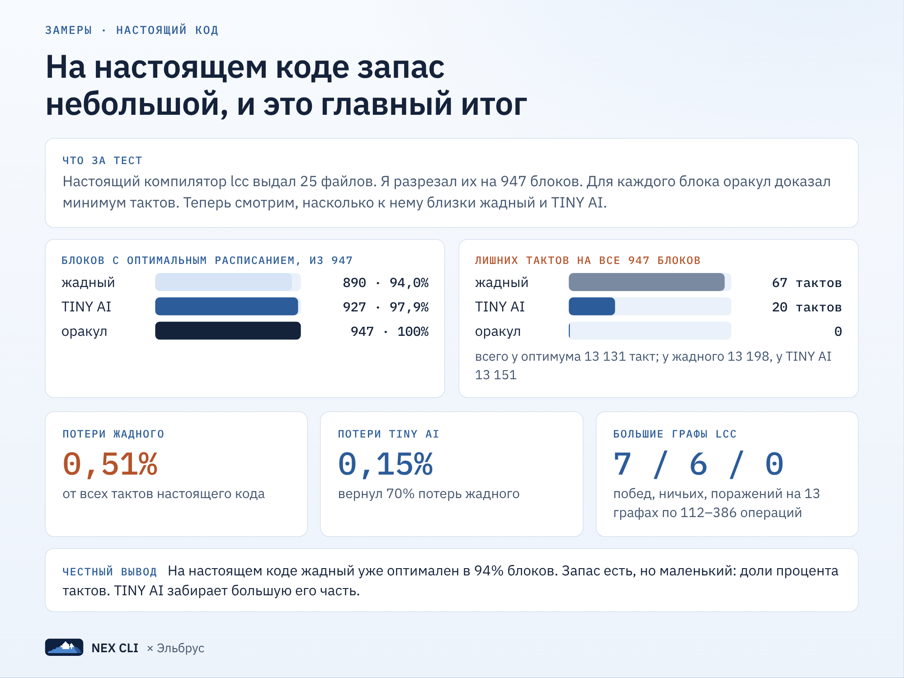
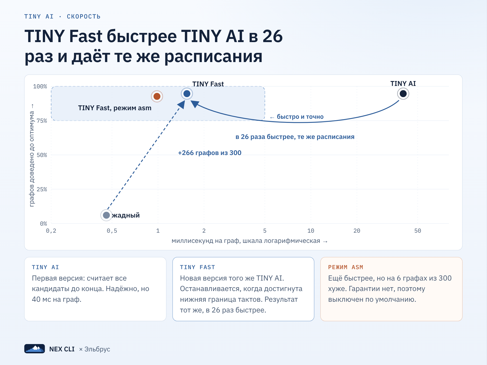
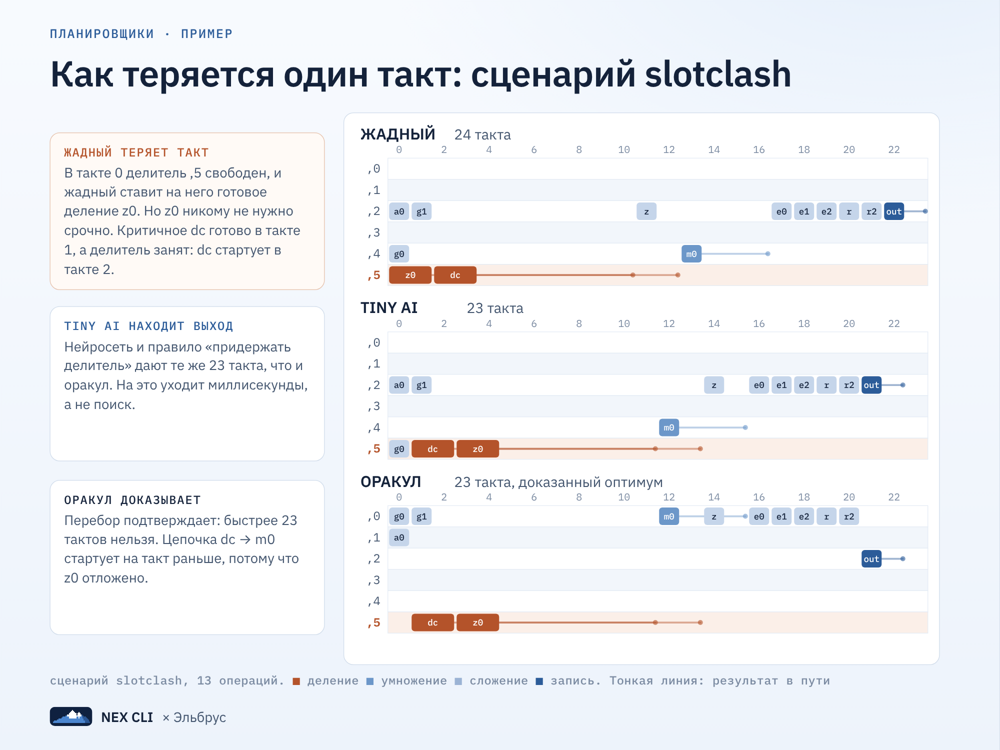
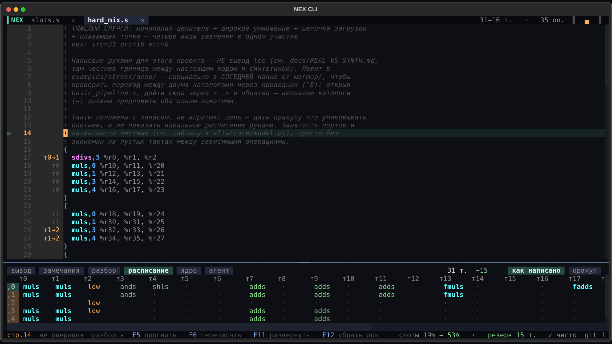
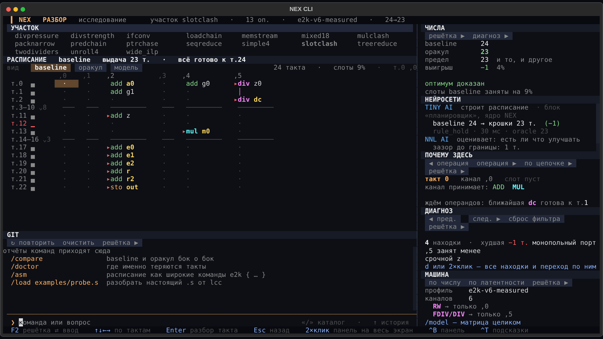
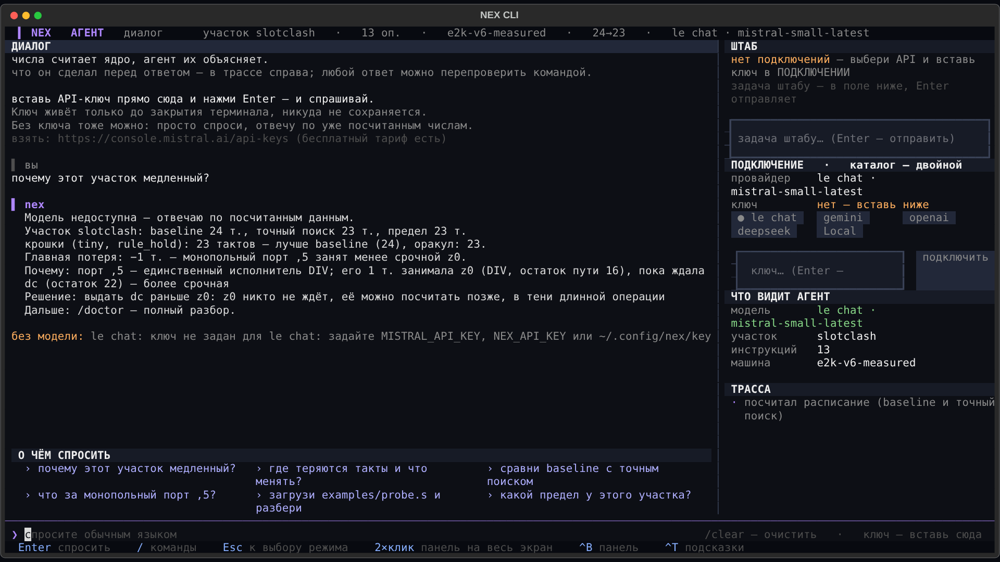
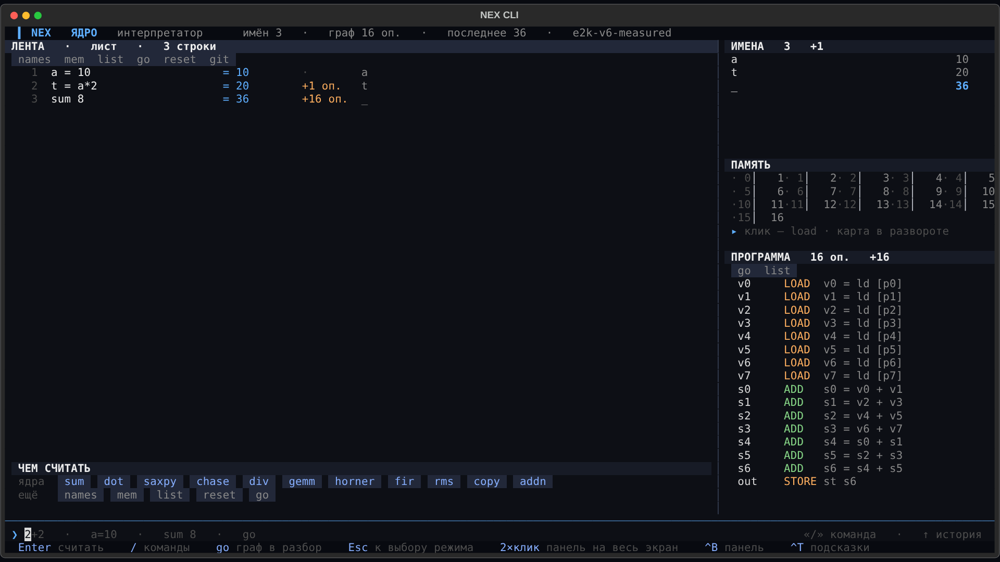
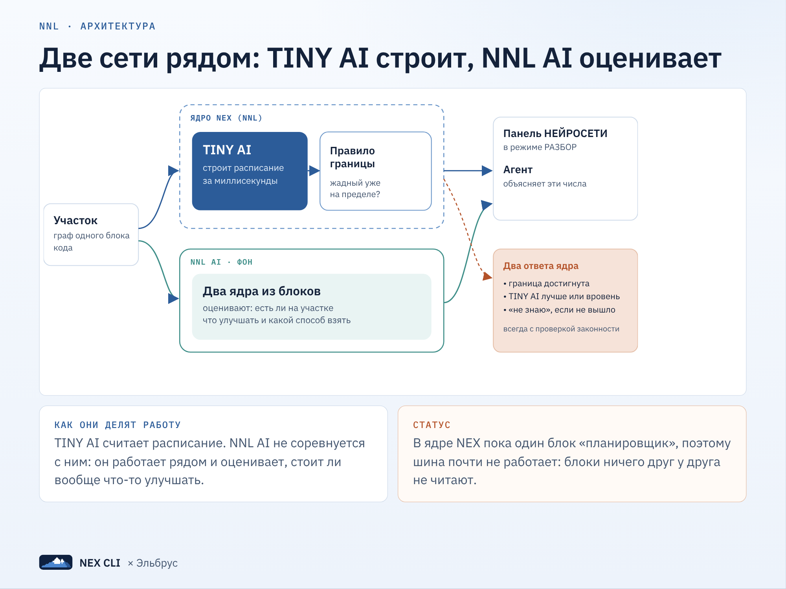

<p align="center">
  
</p>

<p align="center">
  
  
  
</p>

**NEX CLI показывает, где код для процессора Эльбрус теряет такты, считает, как можно лучше, и проверяет, помогает ли в этом нейросеть.**

Эльбрус выполняет до шести операций за такт, а раскладывает их компилятор `lcc` заранее. NEX CLI берёт готовый `.s`-файл,
режет его на блоки и сравнивает три способа расписания на одной и той же модели машины:

<p align="center">
  
</p>

> **Текущая версия: 1.3** (22.10.2026). Рядом работают две нейросети: **TINY AI** строит расписание, **NNL AI** оценивает,
> есть ли что улучшать. В основную ветку влито ядро NEX (`nex_core/`). Проверка: `python3 -m vliw --version`.
> Это модельные такты, а не замеры на железе; режим `loop_mode` пока не моделируется.

## Что получилось

| | жадный | TINY AI | точный оптимум |
|---|---|---|---|
| настоящий код, оптимальных блоков из 947 | 890 | **927** | 947 |
| трудные графы, из 300 | 18 | **284** | 300 |
| время на блок | 0,4 мс | 0,6 мс (TINY Fast) | до 20 с |

На настоящем коде жадный уже оптимален в 94% блоков, а потери всего 0,51% тактов. TINY AI возвращает около 70% этих потерь
и не делает хуже жадного ни на одном из 1 547 проверенных графов.

<p align="center">
  
  
</p>

Как теряется один такт, на примере `slotclash`:

<p align="center">
  
</p>

## Как это выглядит

Запуск: `python3 -m vliw` открывает экран выбора, дальше четыре режима.

<p align="center">
  
  
  
  
</p>

| режим | для чего | подробно |
|---|---|---|
| **КОД** (1) | редактор `.s`, расписание в номерах строк, замечания, F5 прогнать | [`docs/CODE_MODE.md`](docs/CODE_MODE.md) |
| **РАЗБОР** (2) | решётка тактов × каналов и панели про клетку под курсором | [`docs/LAB_MODE.md`](docs/LAB_MODE.md) |
| **АГЕНТ** (3) | вопрос обычным языком, ответ по уже посчитанным числам | [`docs/AGENT_PROMPTS.md`](docs/AGENT_PROMPTS.md) |
| **ЯДРО** (4) | интерпретатор: из вычислений строится граф | [`docs/CORE_MODE.md`](docs/CORE_MODE.md) |

## Быстрый старт

```bash
git clone https://github.com/smworklair/NEX-CLI-x-Elbrus
cd NEX-CLI-x-Elbrus
pip install -e ".[tui]"           # ядро работает и без этого; полноэкранные режимы нужны rich и textual
python3 -m vliw                   # экран выбора режимов
python3 -m vliw run slotclash     # сразу на примере
python3 -m vliw all               # все 17 сценариев текстом
python3 -m unittest discover -s tests
```

Нужен только Python 3.10+. `lcc` и железо не требуются. На Windows: [`docs/WINDOWS.md`](docs/WINDOWS.md).

## Что внутри

- **Жадный планировщик и точный поиск**: `vliw/core/`. Модель машины e2k-v6 измерена, у каждого числа указан источник.
- **TINY AI**: `vliw/tiny/`. Три сети по ~10 тысяч чисел подсказывают порядок, отсрочки и «придержать»; расписание строит обычный код,
  поэтому оно законно по построению. Быстрая версия: [`docs/TINY_FAST.md`](docs/TINY_FAST.md).
- **NNL (Neural Network Lego)**: `nnl_vliw/`, `nnl_isa/`, `nex_core/`. Нейросеть из блоков из другого проекта. Пока работает в фоне
  и выигрыша не даёт: [`nnl_vliw/README.md`](nnl_vliw/README.md).
- **Агент**: `vliw/agent/`. 15 провайдеров, ключ только в памяти сессии, каждый шаг можно повторить командой.

<p align="center">
  
</p>

## Честные границы

- Такты модельные: на живом Эльбрусе не проверены, латентности сняты с компилятора и ассемблера.
- Обученная языковая модель (Qwen2.5-3B + LoRA) не обошла случайный перебор ни на одном из 13 настоящих графов: [отчёт](real_candidates_100_400/model_eval/REPORT.md).
  Gemma и Phi эффекта тоже не дали. Поэтому в проекте работают маленькие сети.
- Первая версия модели машины была неверна («разрыв 18%» оказался 3%); профиль оставлен как `e2k-v6-firstprobe`, разбор в полной версии README.
- NNL на настоящем коде почти не лучше случайного отказа.

## Документация

| | |
|---|---|
| [`docs/FULL_README.md`](docs/FULL_README.md) | **полная версия этого README**: методика, калибровка, разбор ошибки модели, ограничения |
| [`docs/README.md`](docs/README.md) | оглавление всей документации |
| [`CHANGELOG.md`](CHANGELOG.md) | история версий |
| [`docs/CLI.md`](docs/CLI.md) | все команды |
| [`docs/ENTHUSIAST.md`](docs/ENTHUSIAST.md) | что менять, как обучить свою модель |
| [`QUICKSTART.md`](QUICKSTART.md), [`CONTRIBUTING.md`](CONTRIBUTING.md) | старт и правила для контрибьюторов |

## Поддержать

Проект делается одним человеком в свободное время и отдаётся как есть, вместе с отрицательными результатами.
Если пригодился: **https://pay.cloudtips.ru/p/7809ff65**. Донат не покупает поддержку или приоритет правок.

## Лицензия

MIT, см. [LICENSE](LICENSE).
