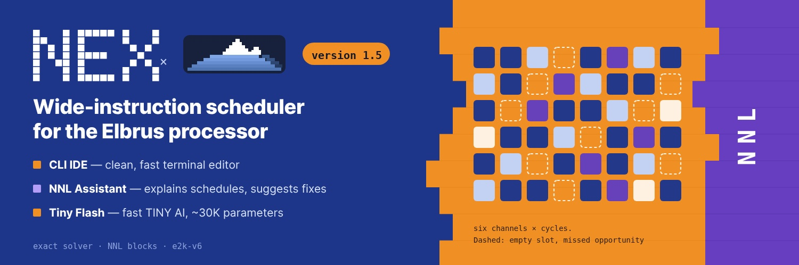
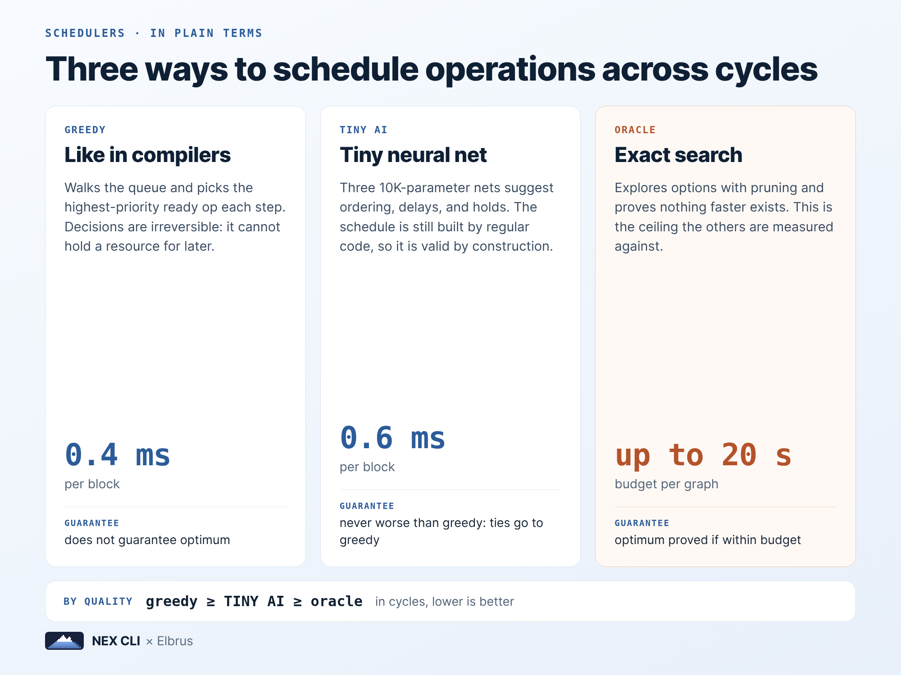
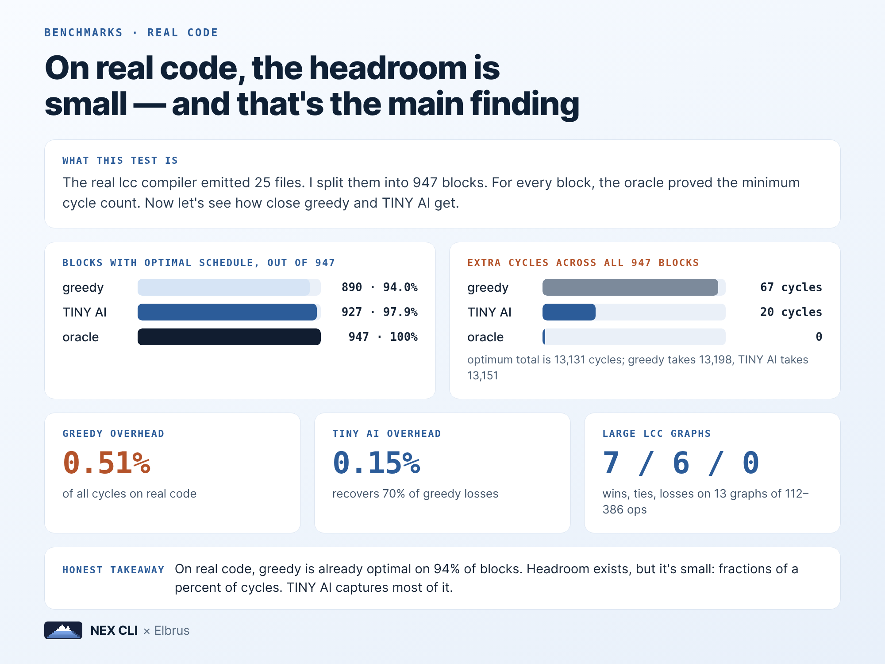
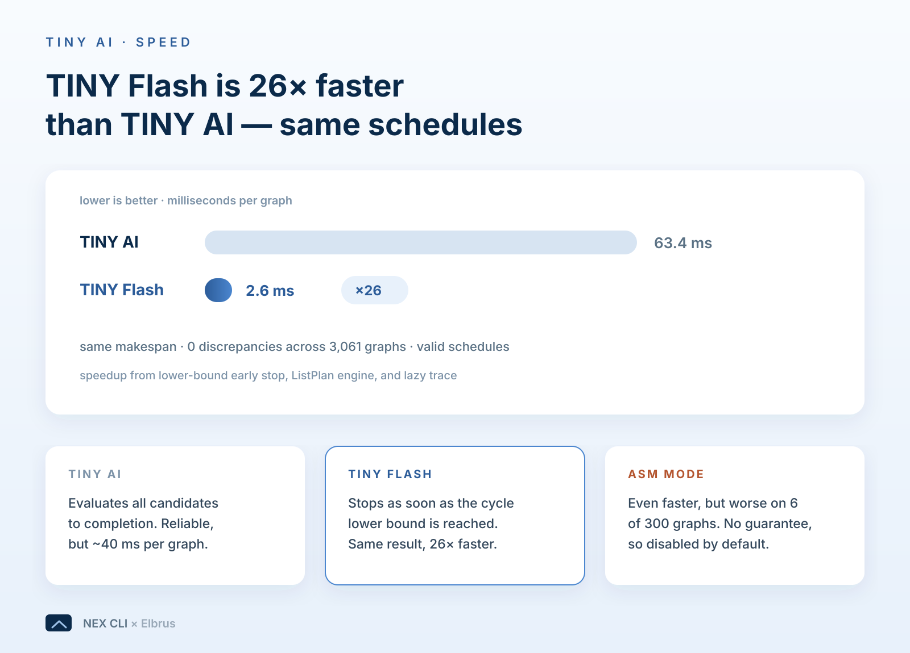
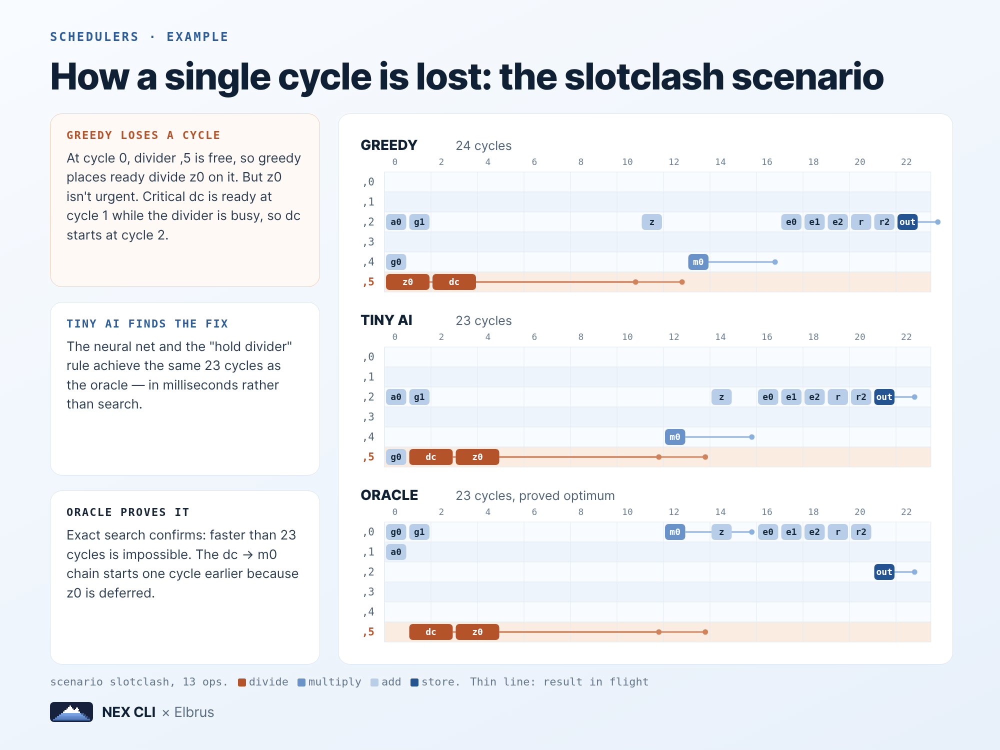
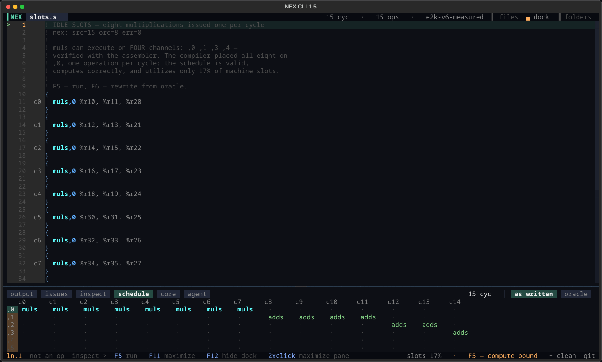
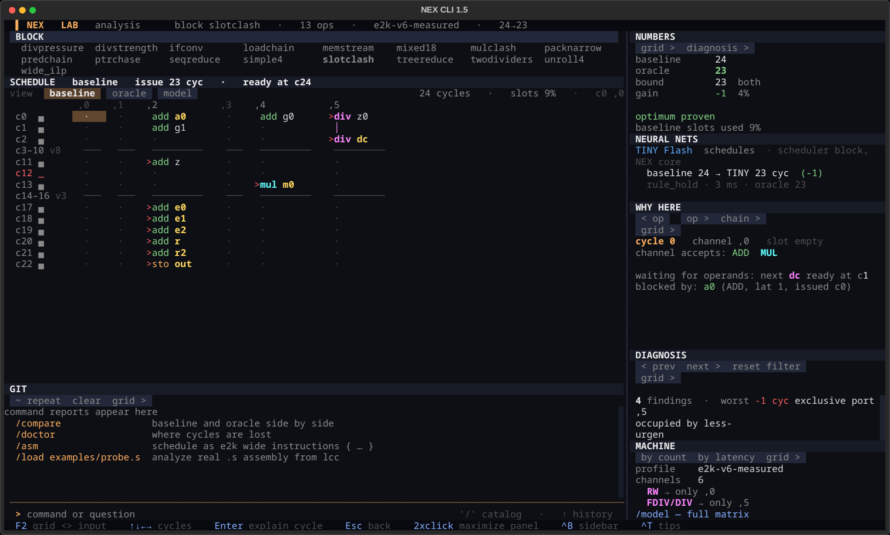
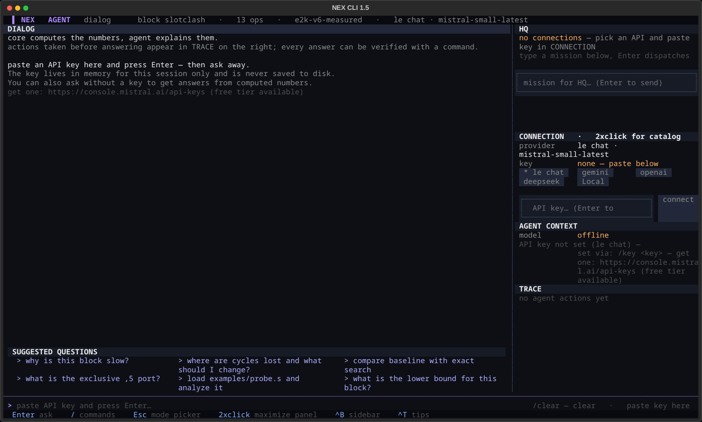
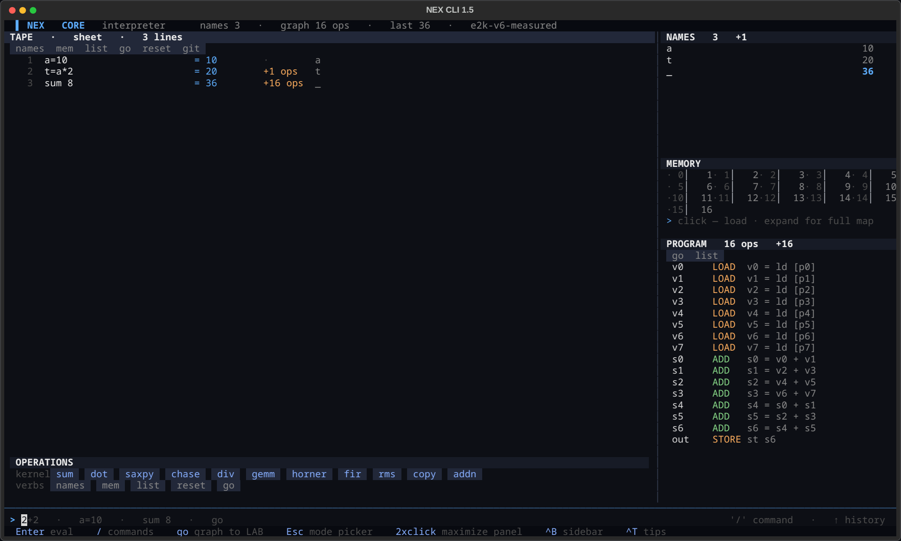

<p align="center">
  
</p>

<p align="center">
  
  
  
</p>

<p align="center">
  <a href="https://github.com/smworklair/NEX-CLI-x-Elbrus/tree/ru">Russian version (v1.4): branch <code>ru</code></a>
</p>

**NEX CLI pinpoints where Elbrus VLIW code loses cycles, computes optimal bundle schedules, and tests whether small neural networks can close the gap.**

Elbrus issues up to six operations per cycle in a wide instruction bundle (VLIW bundle), statically scheduled at compile time by `lcc`. NEX CLI ingests a compiled `.s` file, partitions it into basic blocks, and benchmarks three schedulers on the same machine model: a greedy list scheduler, an exact branch-and-bound oracle, and a learned policy.

<p align="center">
  
</p>

> **Current version: 1.5** (2026-11-27). Cycle counts are model-based, not hardware measurements; `loop_mode` (software-pipelined loops) is not modeled yet.
> Check version: `python -m vliw --version`. What's new: [`CHANGELOG.md` §1.5](CHANGELOG.md#15-2026-11-27).

## Results

| | greedy baseline | TINY Flash | exact optimum |
|---|---|---|---|
| real code, optimal basic blocks out of 947 | 890 | **927** | 947 |
| hard graphs, out of 300 | 18 | **284** | 300 |
| time per basic block | 0.4 ms | 0.6 ms | up to 20 s |

On real code, the greedy list scheduler baseline already hits the optimum on 94% of basic blocks, leaving only 0.51% in recoverable cycles. TINY Flash (the fast runtime for TINY AI) recovers roughly 70% of that scheduling headroom and never regresses against the baseline on any of the 1,547 tested graphs.

<p align="center">
  
  
</p>

How a single cycle is lost to functional-unit contention, illustrated on `slotclash`:

<p align="center">
  
</p>

## What It Looks Like

Running `python -m vliw` opens the mode selector with four workspaces. If `textual` is not installed yet, a setup assistant opens instead: it offers to install the missing packages and launches the workspace automatically once confirmed.

<p align="center">
  
  
  
  
</p>

| mode | purpose | details |
|---|---|---|
| **CODE** (1) | `.s` editor, bundle schedule mapped to source lines, diagnostics, `F5` to run | [`docs/CODE_MODE.md`](docs/CODE_MODE.md) |
| **LAB** (2) | cycles × issue slots grid with synchronized detail panels for the cell under the cursor | [`docs/LAB_MODE.md`](docs/LAB_MODE.md) |
| **AGENT** (3) | natural-language Q&A grounded in computed schedule metrics | [`docs/AGENT_PROMPTS.md`](docs/AGENT_PROMPTS.md) |
| **CORE** (4) | interpreter: constructs a data-dependency graph directly from expressions | [`docs/CORE_MODE.md`](docs/CORE_MODE.md) |

## Quick Start

```bash
git clone https://github.com/smworklair/NEX-CLI-x-Elbrus
cd NEX-CLI-x-Elbrus
pip install -e ".[tui]"              # core works without this; rich and textual are needed for fullscreen modes
python -m vliw                       # mode selection screen
python -m vliw run slotclash         # run immediately on an example
python -m vliw all                   # all 17 scenarios in plain text
python -m unittest discover -s tests
```

Requires only Python 3.10+. Neither `lcc` nor Elbrus hardware is required. For Windows, see [`docs/WINDOWS.md`](docs/WINDOWS.md).

## Where to Start

- **Understand what the project does** — this README is enough. No installation needed.
- **Run it** — [`QUICKSTART.md`](QUICKSTART.md), then [`docs/CLI.md`](docs/CLI.md): about 15 minutes.
- **Dive deeper** — [`docs/README.md`](docs/README.md): stages 3–13, intended as reference rather than front-to-back reading.

Quick sanity check that everything is wired up: `python -m vliw`.

## What's Inside

- **Greedy list scheduler and exact solver** — `vliw/core/`. Empirically calibrated `e2k-v6` machine model; every parameter cites its measurement source.
- **TINY AI** — `vliw/tiny/`. Small neural networks advise priority ordering, defers, and holds; deterministic list-scheduling code emits the final VLIW bundles, so schedules are legal by construction. Numbers and retraining: [`docs/TINY.md`](docs/TINY.md).
- **NNL core (active)** — `nex_core/`. Packages TINY AI as a self-verifying scheduler NNL block (passport, weights, SHA-256). Through it, TINY AI drives both the NEURAL NETS panel and the agent. A second NNL block handles setup-assistant queries.
- **NNL experiments** — `nnl_vliw/`, `nnl_isa/`. Experimental cores for portfolio-group selection and mnemonic classification. Functional, but they yield no gain on real code and are not wired into the CLI: [`nnl_vliw/README.md`](nnl_vliw/README.md), [`nnl_isa/README.md`](nnl_isa/README.md).
- **Agent** — `vliw/agent/`. 17 providers, API keys held strictly in session memory, every step reproducible via a CLI command.

## Honest Boundaries

- Cycle counts are model-based and have not been validated on physical Elbrus silicon. Issue-slot legality was probed via the assembler; latencies were inferred from `lcc` scheduling behavior.
- A fine-tuned LLM (Qwen2.5-3B + LoRA) failed to beat random search on any of the 13 real graphs: [report](real_candidates_100_400/model_eval/REPORT.md). Gemma and Phi showed no benefit either. That negative result is why the project uses compact MLPs instead.
- The first version of the machine model was wrong (the apparent "18% gap" collapsed to 3%); that profile is preserved as `e2k-v6-firstprobe`, with a postmortem in the [research archive](docs/archive/FULL_README.md).
- Experimental NNL cores for portfolio-group selection perform barely better than random abstention on real code.

## For Elbrus Specialists

If you have worked with `lcc` and Elbrus VLIW bundles, here is a concise summary of what this model captures and what it omits.

- **Counts are model cycles, not hardware cycles.** Profile `e2k-v6-measured`: 24 operation classes, 160 mnemonics.
- **Issue slots (channels)** `ALC0…ALC5` (`,0`..`,5`) were probed directly against the assembler: illegal slot assignments are rejected.
- **Latencies** were inferred from dependent-chain bundle spacing in `lcc -O3`; measured for 11 of 24 classes, defaulting to 1 cycle for the remaining 13.
- **Cross-check against the MCST manual** (release 1.2, 2024-02-28): 10 of 13 comparable classes matched; `LOAD` 5 vs. 3 reflects the generational difference between E4C/E8C and `e2k-v6`.
- **On real `lcc` output**, 37% of operations fall into `UNKNOWN`: DAG topology is preserved, but timings are not.
- **Comparison** evaluates the greedy list scheduler, TINY AI, and the exact solver within the same machine model; `lcc`'s own schedule is not benchmarked as a separate baseline.
- **No physical hardware was used.** `loop_mode` (software-pipelined loops), inter-cluster delays, and `fp→int +2` cross-domain penalties are not modeled.

Details: [`docs/METHOD.md`](docs/METHOD.md). This project is not affiliated with MCST; `lcc` was not modified and only the public toolchain is used.

## Documentation

Full reading path: [`docs/README.md`](docs/README.md). Overview:

| document | topic |
|---|---|
| [`docs/README.md`](docs/README.md) | reading roadmap across all docs, stages 0–12 |
| [`QUICKSTART.md`](QUICKSTART.md) | stage 1: up and running in a couple of minutes |
| [`docs/CLI.md`](docs/CLI.md) | stage 2: installation, all commands, exit codes |
| [`docs/METHOD.md`](docs/METHOD.md) | stage 3: where the numbers come from and model boundaries |
| [`docs/ISA.md`](docs/ISA.md) | stage 10: `e2k-v6` machine model |
| [`docs/ENTHUSIAST.md`](docs/ENTHUSIAST.md) | stage 13: what to modify and how to train your own model |
| [`CHANGELOG.md`](CHANGELOG.md) | version history |
| [`CONTRIBUTING.md`](CONTRIBUTING.md) | contributor guidelines |

Historical notes and negative results live in [`docs/archive/`](docs/archive/).

## Support

This project is built by one person in their spare time and shared as-is, negative results included.
If you find it useful: **https://pay.cloudtips.ru/p/7809ff65**. Donations do not buy support or priority fixes.

## License

The source code is visible, but this is **not open-source**: free use is permitted for educational and personal purposes only. Commercial or corporate use requires a separate paid agreement with the copyright holder. Full terms: [LICENSE](LICENSE).

Licensing inquiries: **smworklair@gmail.com**, Telegram **@smworklair**.
