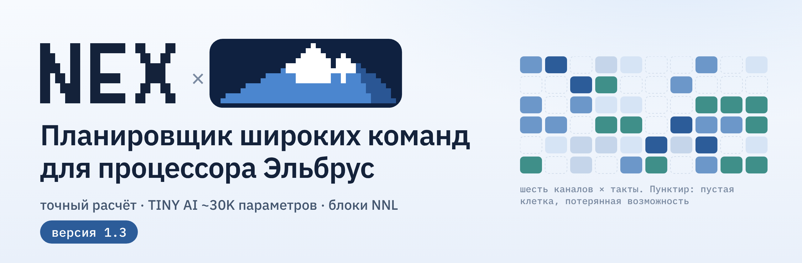
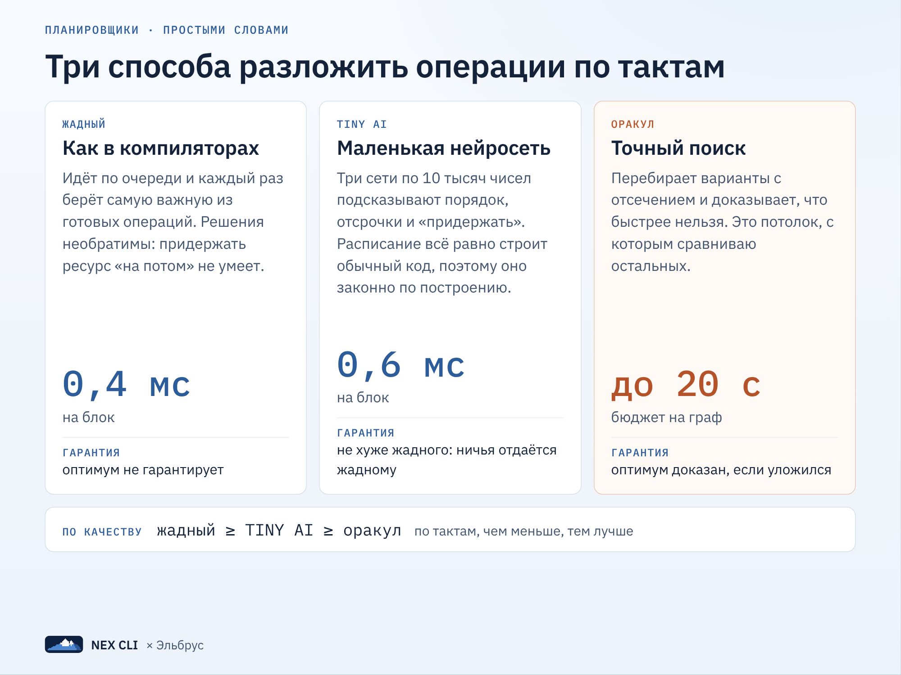
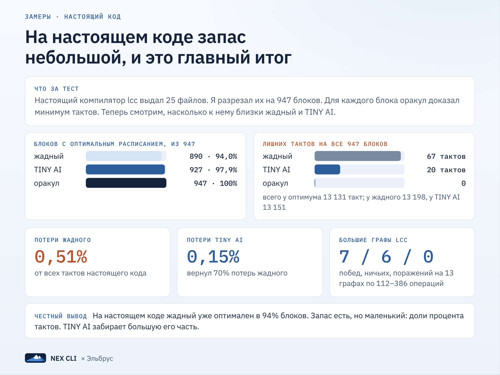
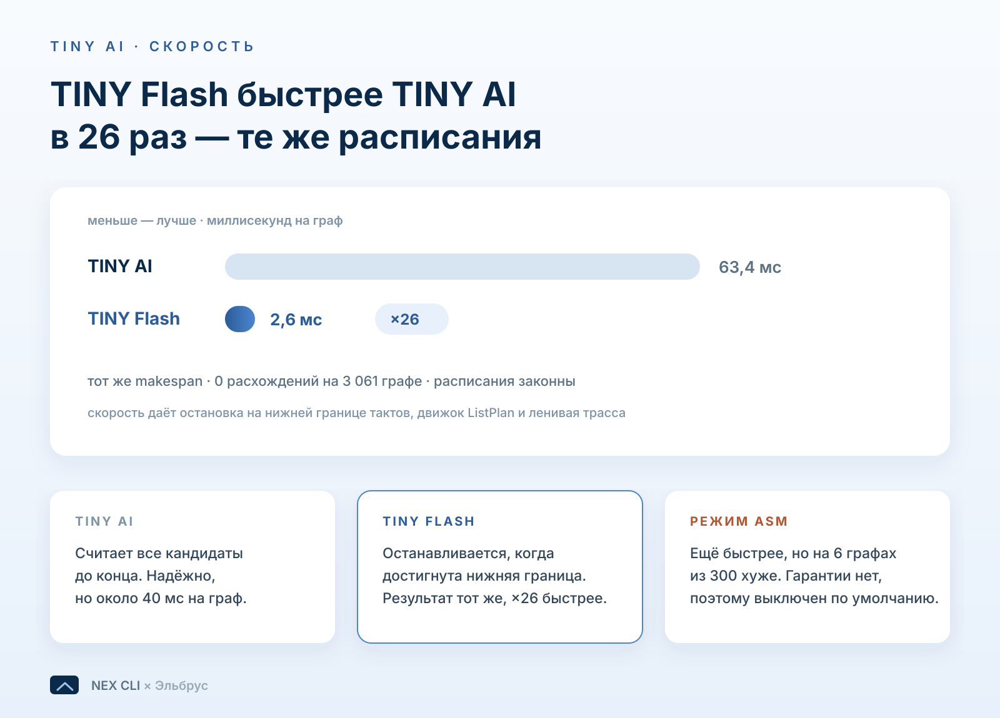
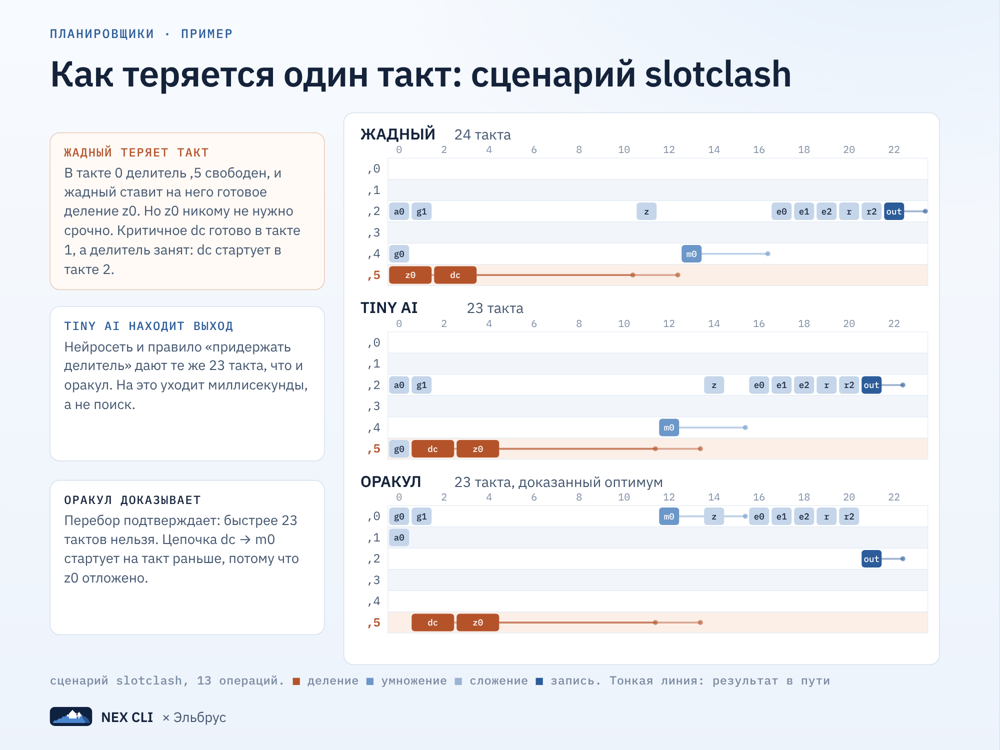
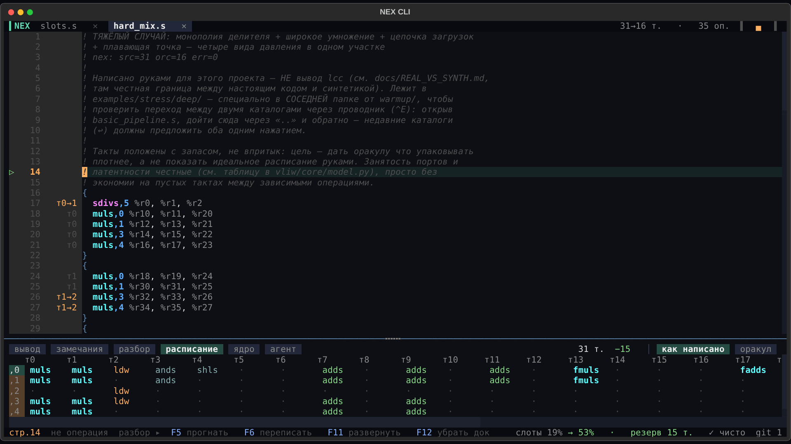
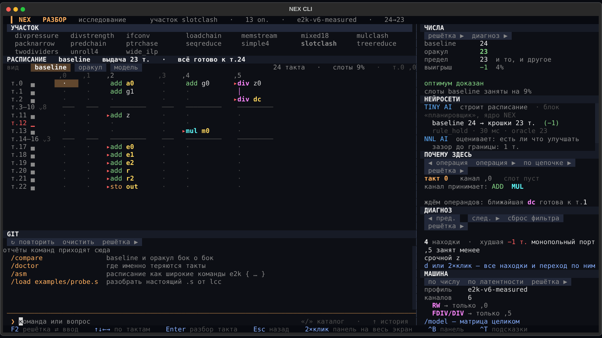
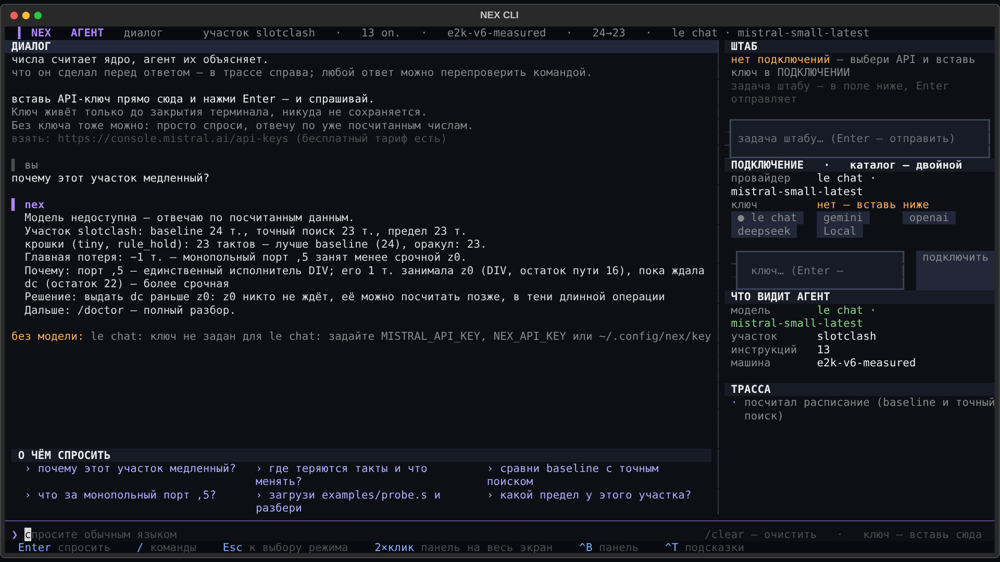
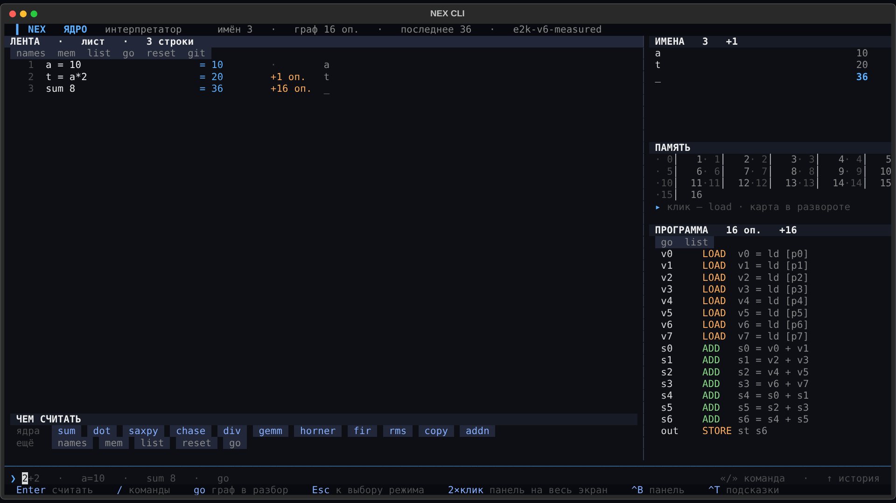

<p align="center">
  
</p>

<p align="center">
  
  
  
</p>

**NEX CLI показывает, где код для процессора Эльбрус теряет такты, считает, как можно лучше, и проверяет, помогает ли в этом нейросеть.**

Эльбрус выполняет до шести операций за такт, а раскладывает их компилятор `lcc` заранее. NEX CLI берёт готовый `.s`-файл,
режет его на блоки и сравнивает три способа расписания на одной и той же модели машины: жадный, точный и обученный.

<p align="center">
  
</p>

> **Текущая версия: 1.4** (11.11.2026). Такты модельные, а не замеры на железе; `loop_mode` пока не моделируется.
> Проверка версии: `python -m vliw --version`. Что нового — [`docs/RELEASE_1_4.md`](docs/RELEASE_1_4.md).

## Что получилось

| | жадный | TINY Flash | точный оптимум |
|---|---|---|---|
| настоящий код, оптимальных блоков из 947 | 890 | **927** | 947 |
| трудные графы, из 300 | 18 | **284** | 300 |
| время на блок | 0,4 мс | 0,6 мс | до 20 с |

На настоящем коде жадный уже оптимален в 94% блоков, а потери — 0,51% тактов. TINY Flash
(тот же планировщик, что TINY AI) возвращает около 70% этих потерь
и не делает хуже жадного ни на одном из 1 547 проверенных графов.

<p align="center">
  
  
</p>

Как теряется один такт, на примере `slotclash`:

<p align="center">
  
</p>

## Как это выглядит

Запуск `python -m vliw` открывает экран выбора, дальше четыре режима. Если `textual` ещё не установлен,
открывается экран-помощник: он предложит поставить недостающее и сам откроет рабочее место после согласия.

<p align="center">
  
  
  
  
</p>

| режим | для чего | подробно |
|---|---|---|
| **КОД** (1) | редактор `.s`, расписание в номерах строк, замечания, F5 — прогнать | [`docs/CODE_MODE.md`](docs/CODE_MODE.md) |
| **РАЗБОР** (2) | решётка тактов × каналов и панели про клетку под курсором | [`docs/LAB_MODE.md`](docs/LAB_MODE.md) |
| **АГЕНТ** (3) | вопрос обычным языком, ответ по уже посчитанным числам | [`docs/AGENT_PROMPTS.md`](docs/AGENT_PROMPTS.md) |
| **ЯДРО** (4) | интерпретатор: из вычислений строится граф | [`docs/CORE_MODE.md`](docs/CORE_MODE.md) |

## Быстрый старт

```bash
git clone https://github.com/smworklair/NEX-CLI-x-Elbrus
cd NEX-CLI-x-Elbrus
pip install -e ".[tui]"              # ядро работает и без этого; для полноэкранных режимов нужны rich и textual
python -m vliw                       # экран выбора режимов
python -m vliw run slotclash         # сразу на примере
python -m vliw all                   # все 17 сценариев текстом
python -m unittest discover -s tests
```

Нужен только Python 3.10+. `lcc` и железо не требуются. На Windows — [`docs/WINDOWS.md`](docs/WINDOWS.md).

## С чего начать

- **Понять, о чём проект** — этого README достаточно. Запускать ничего не обязательно.
- **Запустить** — [`QUICKSTART.md`](QUICKSTART.md), затем [`docs/CLI.md`](docs/CLI.md): около 15 минут.
- **Разобраться** — [`docs/README.md`](docs/README.md): этапы 3–13, открывать по потребности, не подряд.

Быстрая проверка, что всё на месте: `python -m vliw`.

## Что внутри

- **Жадный планировщик и точный поиск** — `vliw/core/`. Модель машины e2k-v6 измерена; у каждого числа указан источник.
- **TINY AI** — `vliw/tiny/`. Маленькие сети подсказывают порядок, отсрочки и «придержать»; расписание строит обычный код,
  поэтому оно законно по построению. Цифры и переобучение: [`docs/TINY.md`](docs/TINY.md).
- **NNL-ядро (рабочее)** — `nex_core/`. Упаковывает TINY AI в NNL-блок «планировщик»: паспорт,
  веса, sha256. Через него TINY AI отвечает панели НЕЙРОСЕТИ и агенту. Ещё один NNL-блок,
  «Помощь_ассистент», отвечает на вопросы экрана-помощника.
- **Эксперименты NNL** — `nnl_vliw/`, `nnl_isa/`. Ядра выбирают группу портфеля и угадывают класс
  мнемоники. Технически работают, но выигрыша на настоящем коде не дают и в CLI не включены:
  [`nnl_vliw/README.md`](nnl_vliw/README.md), [`nnl_isa/README.md`](nnl_isa/README.md).
- **Агент** — `vliw/agent/`. 17 провайдеров, ключ только в памяти сессии, каждый шаг можно повторить командой.

## Честные границы

- Такты модельные: на живом Эльбрусе не проверены. Каналы сняты у ассемблера, латентности —
  с поведения `lcc`.
- Обученная языковая модель (Qwen2.5-3B + LoRA) не обошла случайный перебор ни на одном из 13 настоящих графов:
  [отчёт](real_candidates_100_400/model_eval/REPORT.md). Gemma и Phi эффекта тоже не дали. Поэтому в проекте работают маленькие сети.
- Первая версия модели машины была неверна («разрыв 18%» оказался 3%); профиль оставлен как `e2k-v6-firstprobe`,
  разбор — в [архиве исследований](docs/archive/FULL_README.md).
- Экспериментальные NNL-ядра выбора группы портфеля на настоящем коде почти не лучше случайного отказа.

## Для специалиста по Эльбрусу

Если вы работали с `lcc` и широкой командой, коротко о том, что здесь есть и чего нет.

- **Считаются такты модели, не железа.** Профиль `e2k-v6-measured`: 24 класса, 160 мнемоник.
- **Каналы** `ALC0…ALC5` сняты вопросом к ассемблеру: неположенный канал отвергается.
- **Латентности** — по шагу цепочки зависимых в `lcc -O3`; измерены у 11 классов из 24,
  у остальных 13 стоит допущение 1.
- **Сверка с руководством МЦСТ** (выпуск 1.2, 2024-02-28): 10 классов из 13 сопоставимых
  совпало; `LOAD` 5 против 3 — разница поколений Е4С/Е8С и e2k-v6.
- **На настоящем выводе `lcc`** 37% операций попадают в `UNKNOWN`: структура графа верна,
  времена — нет.
- **Сравнение** — жадный, TINY AI и точный оптимум внутри одной модели; расписание самого
  `lcc` отдельным baseline не оценивается.
- **Живое железо не использовалось.** `loop_mode`, межкластерные задержки и `fp→int +2`
  не моделируются.

Подробно: [`docs/METHOD.md`](docs/METHOD.md). Проект не связан с АО «МЦСТ»; `lcc`
не модифицировался, используется публичный тулчейн.

## Документация

Полный маршрут чтения — [`docs/README.md`](docs/README.md). Коротко:

| документ | о чём |
|---|---|
| [`docs/README.md`](docs/README.md) | маршрут по всем документам, этапы 0–12 |
| [`QUICKSTART.md`](QUICKSTART.md) | этап 1: запуск за пару минут |
| [`docs/CLI.md`](docs/CLI.md) | этап 2: установка, все команды, коды возврата |
| [`docs/METHOD.md`](docs/METHOD.md) | этап 3: откуда числа и где границы модели |
| [`docs/ISA.md`](docs/ISA.md) | этап 10: модель машины e2k-v6 |
| [`docs/ENTHUSIAST.md`](docs/ENTHUSIAST.md) | этап 13: что менять, как обучить свою модель |
| [`CHANGELOG.md`](CHANGELOG.md) | история версий |
| [`CONTRIBUTING.md`](CONTRIBUTING.md) | правила для контрибьюторов |

Исторические заметки и отрицательные результаты — в [`docs/archive/`](docs/archive/).

## Поддержать

Проект делается одним человеком в свободное время и отдаётся как есть, вместе с отрицательными результатами.
Если пригодился: **https://pay.cloudtips.ru/p/7809ff65**. Донат не покупает поддержку или приоритет правок.

## Лицензия

Исходники открыты, но это **не open-source**: бесплатно — только для обучения и личного
использования. Коммерческое или корпоративное использование — по отдельному платному
соглашению с правообладателем. Полные условия — [LICENSE](LICENSE).

Связь по лицензии: **smworklair@gmail.com**, Telegram **@smworklair**.
