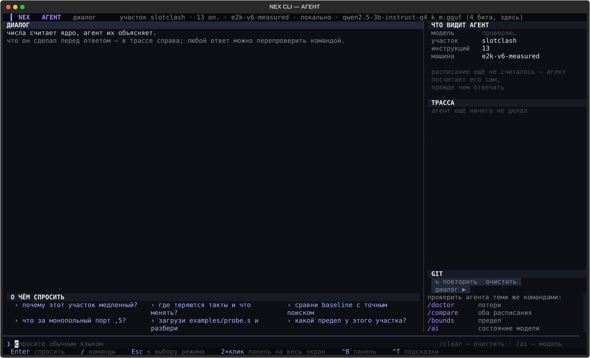

# Промты для агента NEX

Короткая шпаргалка, не путеводитель — АГЕНТ устроен просто: он отвечает
по числам, которые планировщик уже посчитал для текущего участка, и умеет
до ответа сам выполнить то, что явно следует из вопроса (загрузить файл,
переключить сценарий). Подробное описание режима не нужно, но набор
проверенных формулировок — да, чтобы не подбирать их на ощупь.

Спросить можно из рабочего места (`Tab`/строка вопроса в РАЗБОРЕ и КОДЕ) или
одной командой: `python -m vliw ask "<вопрос>"`.

При входе в АГЕНТ без ключа он сам просит вставить ключ прямо в диалог:
вставил — и спрашивай, провайдер угадывается по виду ключа (sk-or-v1 —
OpenRouter, AIza — Gemini, иначе Mistral). Склеенная вставка чинится сама
(двойная вставка, мусор спереди, хвост длиннее нормы 73 — скажет, что
убран). Ключ живёт только до закрытия терминала и никуда не сохраняется:
ни в `.env`, ни в git, ни в историю строки. Проигнорировал и спросил сразу — отвечу офлайн по посчитанным
числам. Всё происходит в одном окне агента: GIT-панели и общего журнала
здесь нет, вывод команд (`/doctor`, `/run`, …) идёт тем же пузырём в диалог.
Тонкая настройка командами (другая модель, второй провайдер) — `/ai`,
`/key`, проверить — `/ai`.



## Готовые вопросы (уже есть в интерфейсе)

Эти пять показаны прямо в приветствии АГЕНТА — они гарантированно попадают
в то, что агент понимает:

```
почему этот участок медленный?
где теряются такты и что менять?
загрузи examples/probe.s и разбери
сравни baseline с точным поиском
что за монопольный порт ,5?
```

## Что происходит на самом деле

**«загрузи ФАЙЛ и разбери»** — не фигура речи. Агент вытаскивает путь из
вопроса, парсит файл сам, ставит его текущим участком и только после этого
отвечает. То же с «переключись на сценарий ИМЯ» — сценарий меняется
по-настоящему, не на словах.

**Любой содержательный вопрос сначала досчитывает расписание**, если оно ещё
не посчитано — baseline и точный поиск. Только после этого агент отвечает,
и числа в ответе — те же самые, что показывает панель ЧИСЛА в РАЗБОРЕ, не
придуманные заново.

**Без ключа модели агент не молчит и не выдумывает.** Первая строка ответа
так и звучит — «Модель недоступна — отвечаю по посчитанным данным», а
дальше идёт содержательный разбор: makespan обоих планировщиков **и крошек**
(третья цифра — `tiny`, считается детерминированно за миллисекунды),
главная потеря такта, почему она возникла, что с ней делать. С ключом
модель получает ту же тройку в ФАКТАХ и объясняет её свободно. Проверить
состояние ключа — `/ai`, прогнать крошки отдельно — `/tiny`.

Смалток («привет», «как дела») агент тоже понимает — отвечает коротко и
без лишнего счёта: приветствие не требует посчитанного расписания, поэтому
на него не тратится время оракула.

## Честно про точность, когда модель подключена

Если модель настроена (`/ai` покажет, какая) — можно спросить что угодно
своими словами, не только из списка выше, и ответ будет живой, не шаблонный.
Но он может быть и **неверным**: при проверке этого же документа модель на
вопрос «на каком канале стоит g1?» ответила «на канале ,2», хотя в настоящем
расписании g1 стоит на ,1 — числа в самой панели ЧИСЛА не соврут никогда,
слова модели поверх них иногда могут. Это тот же вывод, что и в
`docs/CAB.md`: модель не добавляет надёжности к тому, что уже посчитано
точно, и вопрос про КОНКРЕТНОЕ число стоит перепроверять по решётке глазами,
а не только по ответу агента.
