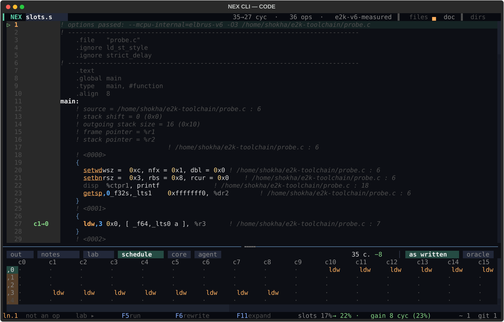

# CODE Mode

> Stage 4 of 13 · [← Methodology](METHOD.md) · [Roadmap](README.md) · [LAB Mode →](LAB_MODE.md)

The workspace for real assembly: load `.s` output from `lcc`, parse it into basic blocks, and schedule it.
Opens with `1` on the mode selector, `/mode code`, or `python -m vliw --mode code`.



## Screen Layout

```
NEX  slots.s              15 cyc · 15 ops · e2k-v6-measured   [files] [dock] [folders]
  1     ! comment
  2  c0   muls,0 %r10, %r11, %r20
...
ln.1  not an op  inspect >  F5 run  F11 expand  F12 hide dock   slots 17%  clean  git
```

- Header: tab name, cycle and operation counts, machine profile, three toggles.
- Editor: line numbers, bundle cycle tags, cursor indicator arrow.
- Footer: cursor position, quick inspection, key hints, schedule status.

## Toggles

| button | key | opens |
|---|---|---|
| `files` | `Ctrl+B` | open tabs list and new-buffer creation |
| `dock` | `F12` | bottom dock with six tabs |
| `folders` | `Ctrl+E` | filesystem explorer |

## Keybindings

| key | action |
|---|---|
| `F5` | run: parse, compute greedy list scheduler and exact solver schedules |
| `F6` | rewrite buffer using the exact branch-and-bound oracle schedule |
| `F11` | expand the active dock tab across the bottom |
| `F12` | show / hide the dock |
| `F2` | rename tab |
| `Ctrl+S` | save |
| `Ctrl+P` or `/` | command bar |
| `Ctrl+G` | explain line under cursor |
| `Ctrl+E` | file explorer |
| `Esc` | step back: hint → explorer → agent tab → expanded tab → exit |

`F2` renames the tab in CODE mode, whereas in LAB mode it toggles focus onto the schedule grid — the two modes maintain separate keymaps.

## Six Dock Tabs

| tab | contents |
|---|---|
| **output** | log of commands and scheduler runs |
| **diagnostics** | linter findings with line numbers; click to jump directly to the line |
| **inspect** | producer operations feeding this instruction and how the exact solver schedules it |
| **schedule** | cycles × issue slots grid for the current buffer |
| **core** | mini-interpreter: `a = 10`, `sum 8`, `go` |
| **agent** | mini-dialogue with the agent |

`F11` expands the active tab. Clicking `ln.N` in the footer jumps straight to the inspect tab.

## F6: Important Caveat

`F6` rewrites the buffer in place: mnemonics and operands stay unchanged while issue-slot assignments (`,0`..`,5`) and VLIW bundle boundaries are recomputed.
The scheduler models only true dependencies (RAW, read-after-write) and ignores false dependencies — anti-dependencies (WAR) and output dependencies (WAW). That is standard for pre-allocation scheduling analysis, where register renaming eliminates false dependencies. Because `F6` emits operations with their original architectural register names, however, a rewritten scheduling region can occasionally violate a WAR/WAW constraint and become invalid.

When that happens, `F6` reports the error count from its own validator rather than claiming success. Review the diagnostics tab before saving.

## File Explorer

`Ctrl+E` opens the filesystem browser: folders, files, `..`, and up to three recent directories.
Search traverses up to four levels deep and accepts full paths, including Windows backslashes.

File deletion requires confirmation and is restricted to files inside the working directory, never built-in examples.

## New Buffer

`files` → "new":

- **e2k basic block** — new `.s` file with a starter hint;
- **note** — `.md` file for scratch notes.

Buffers are numbered sequentially and can be renamed with `F2`.

## Examples

```text
/load examples/probe.s
F5
/load examples/stress/deep/hard_mix.s
F6
```

The boundary between real code and synthetic benchmarks is covered in [`REAL_VS_SYNTH.md`](REAL_VS_SYNTH.md).
