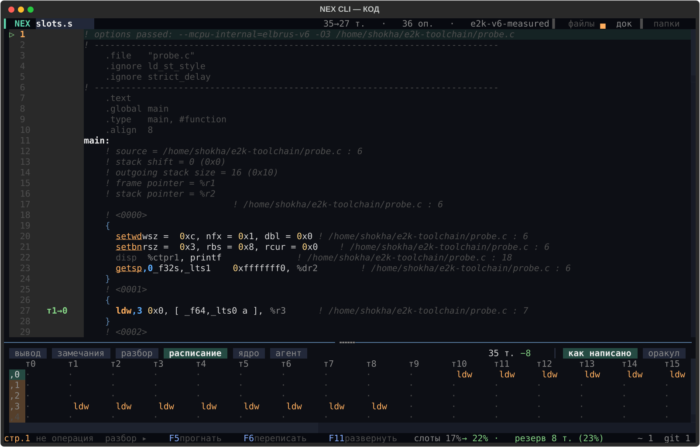

# Режим КОД

> Этап 4 из 13 · [← Методика](METHOD.md) · [Маршрут](README.md) · [Режим РАЗБОР →](LAB_MODE.md)

Рабочее место с настоящим ассемблером: сюда приносят `.s` от `lcc`, разбирают его и прогоняют.
Открывается клавишей `1` на экране выбора, командой `/mode code` или запуском `python -m vliw --mode code`.



## Экран

```
NEX  slots.s              15 т. · 15 оп. · e2k-v6-measured   [файлы] [док] [папки]
  1     ! комментарий
  2  т0   muls,0 %r10, %r11, %r20
...
стр.1  не операция  разбор >  F5 прогнать  F11 развернуть  F12 убрать док   слоты 17%  чисто  git
```

- Шапка: имя вкладки, число тактов и операций, профиль машины, три переключателя.
- Редактор: номера строк, метки тактов, стрелка у строки под курсором.
- Подвал: позиция курсора, краткий разбор, подсказки, состояние расписания.

## Переключатели

| кнопка | клавиша | что открывает |
|---|---|---|
| `файлы` | `Ctrl+B` | список открытых вкладок и создание новых |
| `док` | `F12` | нижняя панель с шестью вкладками |
| `папки` | `Ctrl+E` | проводник файловой системы |

## Клавиши

| клавиша | действие |
|---|---|
| `F5` | прогнать: разобрать, посчитать жадный и точный поиск |
| `F6` | переписать буфер по расписанию точного поиска |
| `F11` | развернуть текущую вкладку дока на весь низ |
| `F12` | показать / убрать док |
| `F2` | переименовать вкладку |
| `Ctrl+S` | сохранить |
| `Ctrl+P` или `/` | строка команд |
| `Ctrl+G` | объяснить строку под курсором |
| `Ctrl+E` | проводник |
| `Esc` | шаг назад: подсказка → проводник → вкладка агента → развёрнутая вкладка → выход |

`F2` в КОДЕ переименовывает вкладку, а в РАЗБОРЕ переключает фокус на решётку — это разные карты клавиш.

## Шесть вкладок дока

| вкладка | что внутри |
|---|---|
| **вывод** | журнал команд и прогонов |
| **замечания** | находки линтера с номерами строк; клик ведёт к строке |
| **разбор** | кто кормит операцию и что с ней сделает точный поиск |
| **расписание** | решётка тактов × каналов для текущего буфера |
| **ядро** | мини-интерпретатор: `a = 10`, `sum 8`, `go` |
| **агент** | мини-диалог с агентом |

`F11` разворачивает текущую вкладку. Клик по `стр.N` в подвале открывает вкладку «разбор».

## F6: важная оговорка

`F6` переписывает буфер: мнемоники и операнды те же, меняются каналы и разбивка на широкие команды.
Планировщик моделирует только истинные зависимости (чтение после записи), а антизависимости (запись после чтения)
не учитывает — для анализа это правильно, их снимает переименование регистров. Но `F6` возвращает операции
с теми же именами регистров, поэтому в редких случаях текст может стать некорректным.

Если это произошло, `F6` сообщит число ошибок собственной проверки, а не объявит успех. Перед сохранением
проверьте вкладку «замечания».

## Проводник

`Ctrl+E` показывает файловую систему: папки, файлы, `..` и до трёх недавних каталогов.
Поиск ищет вглубь до четырёх уровней и понимает путь целиком, в том числе с обратными слэшами Windows.

Удаление файла требует подтверждения и доступно только для файлов рабочего каталога, не для встроенных примеров.

## Новый буфер

`файлы` → «завести»:

- **участок e2k** — новый `.s` с подсказкой;
- **заметка** — `.md` для записей.

Имя даётся по порядку, переименовать можно через `F2`.

## Примеры

```text
/load examples/probe.s
F5
/load examples/stress/deep/hard_mix.s
F6
```

Граница между настоящим кодом и синтетикой — в [`REAL_VS_SYNTH.md`](REAL_VS_SYNTH.md).
