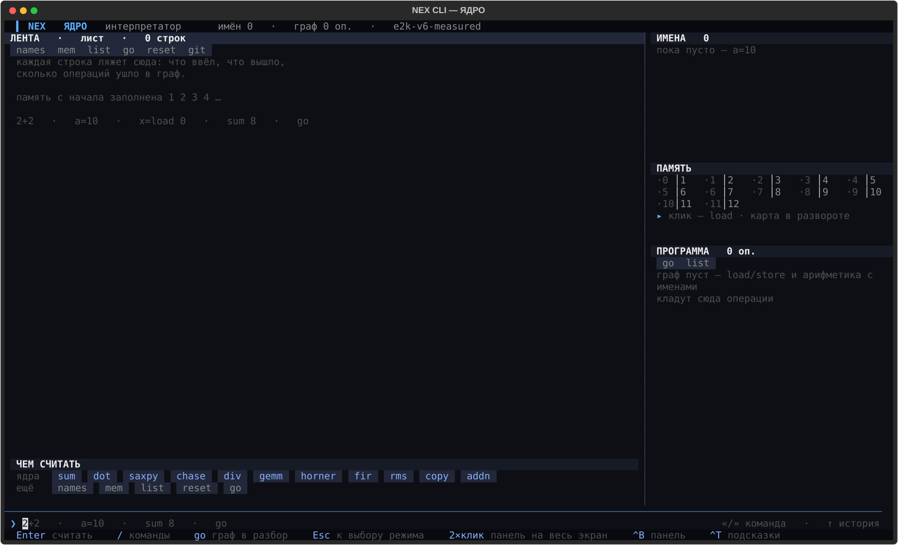

# Режим ЯДРО

> Этап 6 из 13 · [← РАЗБОР](LAB_MODE.md) · [Маршрут](README.md) · [Агент →](AGENT_PROMPTS.md)

Простой интерпретатор, который попутно строит граф зависимостей из обычных вычислений.
Это не про ассемблер, а про то, как граф получается шаг за шагом.

Открывается клавишей `4`, командой `/mode work` или `python -m vliw --mode work`.



## Панели

- **ЛЕНТА** — история ввода и вычислений.
- **ИМЕНА** — переменные и значения.
- **ПРОГРАММА** — накопленный граф.

## Команды

| команда | что делает |
|---|---|
| `a = 10`, `t = a*2` | вычислить и добавить в граф |
| `names` | показать имена и значения |
| `mem` | показать память |
| `list` | показать граф целиком |
| `go` | отдать граф в РАЗБОР и посчитать расписание |
| `reset` | обнулить и начать заново |

Готовые ядра: `sum 8`, `dot 4`, `saxpy 8`, `fir 8` — число задаёт размер.

## Пример

```text
sum 8
go
```

После `go` тот же граф открывается в РАЗБОРЕ со всеми панелями.

Небольшая версия ЯДРА есть вкладкой в [КОДЕ](CODE_MODE.md) — выходить из редактора не обязательно.
