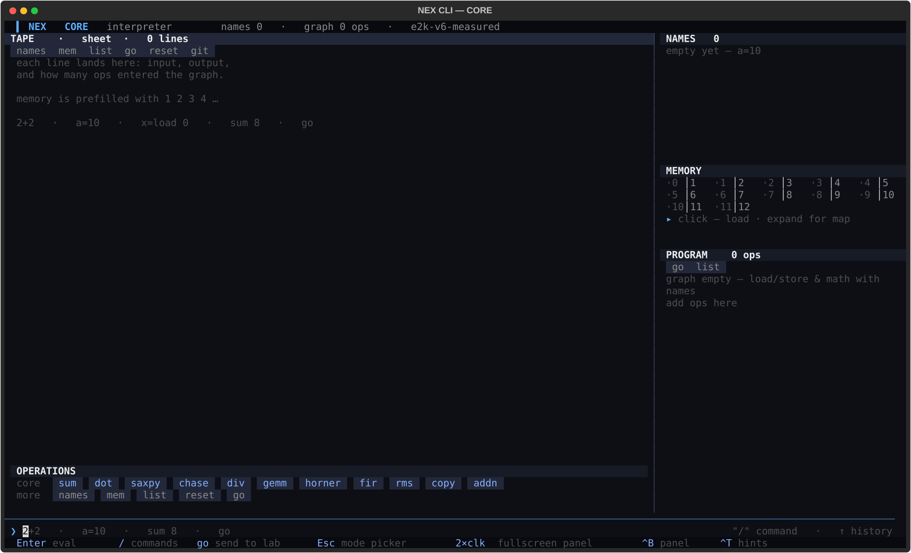

# CORE Mode

> Stage 6 of 13 · [← LAB](LAB_MODE.md) · [Roadmap](README.md) · [Agent →](AGENT_PROMPTS.md)

A simple interpreter that builds a dependency graph as a side effect of ordinary calculations.
It is not about assembly syntax — it shows how a dependency graph emerges step by step.

Opens with `4`, `/mode work`, or `python -m vliw --mode work`.



## Panels

- **TAPE** — input and evaluation history.
- **NAMES** — variables and values.
- **PROGRAM** — accumulated dependency graph.

## Commands

| command | what it does |
|---|---|
| `a = 10`, `t = a*2` | evaluate and append to the graph |
| `names` | show variables and values |
| `mem` | show memory state |
| `list` | show the full graph |
| `go` | send the graph to LAB and compute its schedule |
| `reset` | clear state and start over |

Built-in kernels: `sum 8`, `dot 4`, `saxpy 8`, `fir 8` — the number sets the problem size.

## Example

```text
sum 8
go
```

After `go`, the generated graph opens in LAB with all analysis panels populated.

A compact version of CORE is also available as a dock tab inside [CODE](CODE_MODE.md), so you don't have to leave the editor.
