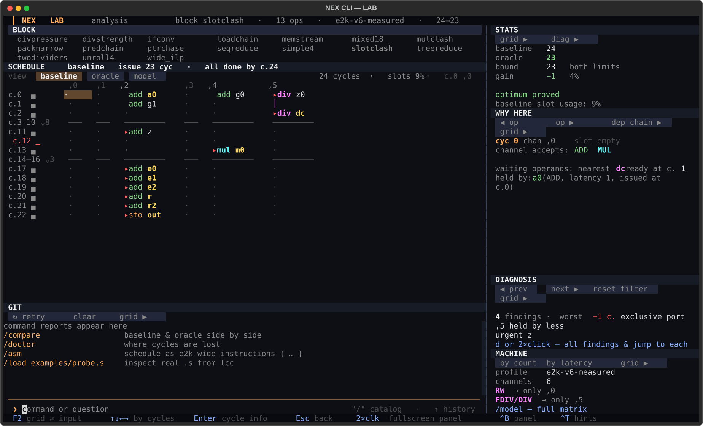

# LAB Mode

> Stage 5 of 13 · [← CODE](CODE_MODE.md) · [Roadmap](README.md) · [CORE Mode →](CORE_MODE.md)

The schedule-analysis workspace: a single basic block, a cycles × issue-slots grid, and synchronized side panels explaining the cell under the cursor. Opens with `2`, `/mode lab`, or `python -m vliw lab`.
The commands `run`, `compare`, `load`, `doctor`, `bounds`, `path`, and `analyze` also open this screen.

## Layout

- Left: **BLOCK** (scenarios), **SCHEDULE** (grid), **GIT** (session log).
- Right: **NUMBERS**, **WHY HERE**, **DIAGNOSIS**, **MACHINE**.
- `Ctrl+B` collapses and expands the right column.

## Focus

Single-key hotkeys work only when focus is on the schedule grid, not in the command input line.
`F2` toggles focus. If a keystroke lands in the command line instead, press `F2` and try again.

## Grid Keybindings

| key | action |
|---|---|
| `↑↓←→` | move cursor across cycles and issue slots (channels) |
| `Enter` | inspect cycle; on a collapsed stall stretch, expand it |
| `[` / `]` | previous / next operation |
| `n` / `N` | next / previous diagnostic finding |
| `c` | step along the critical path |
| `d` | expand full diagnosis |
| `o` | expand session log |
| `v` | toggle view: baseline ⇄ exact oracle |
| `z` | highlight only DAG neighbors of the operation under cursor |
| `x` | expand all stall stretches |
| `p` | toggle critical-path highlighting |
| `w` | toggle wide / narrow cell width |
| `2×click` | expand panel to fullscreen |
| `Esc` | collapse panel; otherwise return to mode selector |
| `Tab` | AI reference panel |

## Panels

**BLOCK.** 17 built-in scenarios, each isolating a specific VLIW scheduling phenomenon: `slotclash` (sole-issue divider contention), `wide_ilp` (functional-unit pressure outweighs critical-path length), `divstrength` (strength-reducing division to a shift), and more. Plain-text list: `/scenarios`.

**SCHEDULE.** Rows are cycles; columns are issue slots `,0`…`,5`. An asterisk marks a sole-issue functional unit (exclusive port). Long idle stretches collapse to `c.3–10 ⌄8`; `x` expands all, `Enter` expands one.

**NUMBERS.** Greedy list scheduler baseline, exact branch-and-bound oracle, theoretical lower bound, and recoverable cycles (absolute and percent). Expanding shows which bound dominates: critical-path length or functional-unit resources.

**WHY HERE.** Explains why that specific operation landed in the cursor cell — or why the slot is idle (RAW latency hazard or functional-unit contention).

**DIAGNOSIS.** Doctor findings ranked by cycle cost. Expanded view (`d`) adds severity filtering along with full root-cause and remediation details.

**MACHINE.** Functional-unit capability matrix: legal issue slots (`,0`..`,5`) and RAW latency per operation class. Expanded view filters by operation name.

**GIT.** Run history for the current session (not a git repository). `/compare`, `/doctor`, `/asm`, and `/load` also log here.

## Key Idea

Every panel tracks the same cursor. Wherever the cursor sits on the schedule grid, every other panel explains that exact cell.
