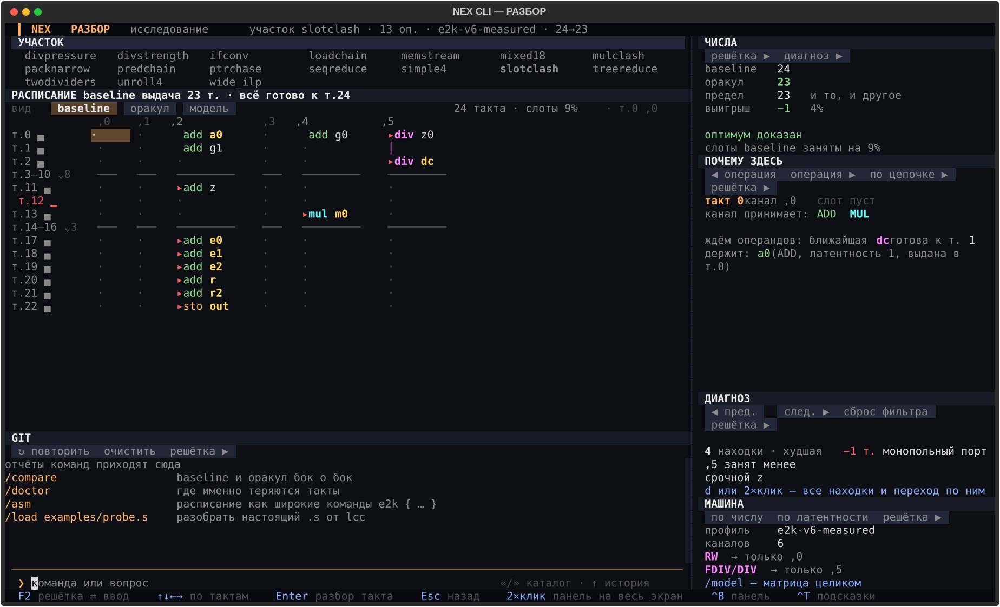

# Режим РАЗБОР

> Этап 5 из 13 · [← КОД](CODE_MODE.md) · [Маршрут](README.md) · [Режим ЯДРО →](CORE_MODE.md)

Исследовательский экран: один участок целиком, решётка тактов × каналов и панели, которые объясняют
клетку под курсором. Открывается клавишей `2`, командой `/mode lab` или `python -m vliw lab`.
Команды `run`, `compare`, `load`, `doctor`, `bounds`, `path`, `analyze` тоже открывают этот экран.

## Планировка

- Слева: **УЧАСТОК** (сценарии), **РАСПИСАНИЕ** (решётка), **GIT** (журнал сессии).
- Справа: **ЧИСЛА**, **ПОЧЕМУ ЗДЕСЬ**, **ДИАГНОЗ**, **МАШИНА**.
- `Ctrl+B` сворачивает и разворачивает правую колонку.

## Фокус

Буквенные клавиши работают, только когда фокус на решётке, а не в строке ввода.
`F2` переключает фокус. Если буква напечаталась в команду, нажмите `F2` и повторите.

## Клавиши решётки

| клавиша | действие |
|---|---|
| `↑↓←→` | курсор по тактам и каналам |
| `Enter` | разбор такта; на схлопнутом простое — развернуть его |
| `[` / `]` | предыдущая / следующая операция |
| `n` / `N` | следующая / предыдущая находка диагноза |
| `c` | шаг по критическому пути |
| `d` | развернуть диагноз целиком |
| `o` | развернуть журнал |
| `v` | переключить вид: baseline ⇄ oracle |
| `z` | подсветить только соседей курсорной операции |
| `x` | развернуть все простои |
| `p` | включить / выключить критический путь |
| `w` | широкая / узкая клетка |
| `2×клик` | развернуть панель на весь экран |
| `Esc` | свернуть панель; без неё — назад к выбору |
| `Tab` | справочник по ИИ |

## Панели

**УЧАСТОК.** 17 встроенных сценариев. Каждый — конкретный урок: `slotclash` (монополия делителя),
`wide_ilp` (ресурсы важнее пути), `divstrength` (деление дешевле заменить сдвигом) и другие.
Список текстом — `/scenarios`.

**РАСПИСАНИЕ.** Строки — такты, столбцы — каналы `,0`…`,5`. Звёздочка у канала — монопольный порт.
Длинные простои схлопываются в `т.3–10 ⌄8`; `x` разворачивает все, `Enter` — один.

**ЧИСЛА.** Жадный, точный поиск, нижняя граница, выигрыш в тактах и процентах.
Разворот показывает, откуда взялась граница: критический путь или ресурсы.

**ПОЧЕМУ ЗДЕСЬ.** Почему в клетке под курсором стоит эта операция — или почему клетка пуста.

**ДИАГНОЗ.** Находки доктора, отсортированные по цене. Развёрнутый вид (`d`) добавляет фильтр
по серьёзности и полный текст «почему» и «что делать».

**МАШИНА.** Матрица портов: какая операция на каком канале живёт и с какой латентностью.
Развёрнутый вид фильтрует по имени операции.

**GIT.** История прогонов этой сессии, не репозиторий. Сюда же пишут `/compare`, `/doctor`, `/asm`, `/load`.

## Главное

Все панели читают один и тот же курсор. Где курсор на решётке — там и ответ остальных панелей.
