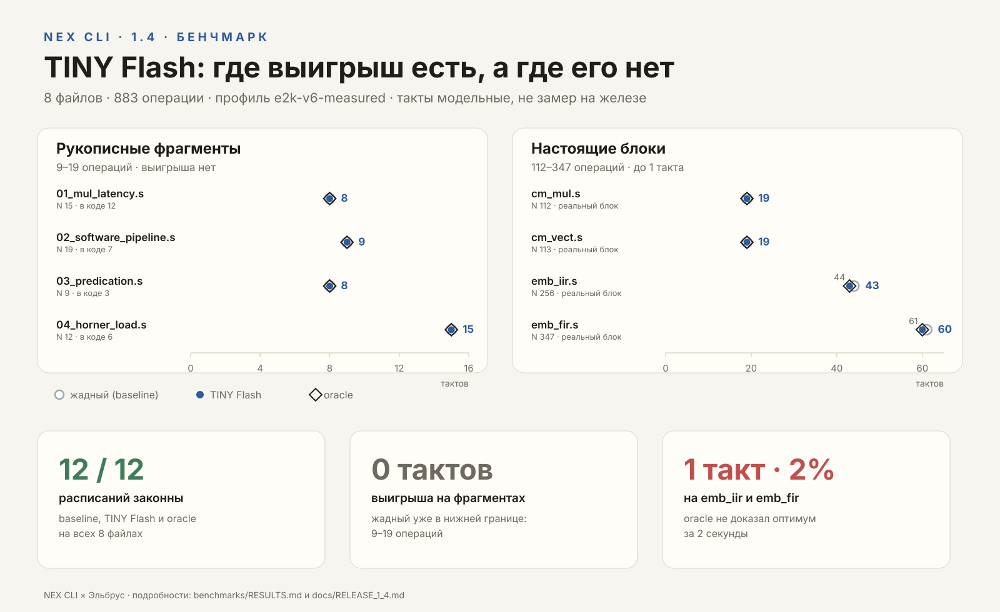
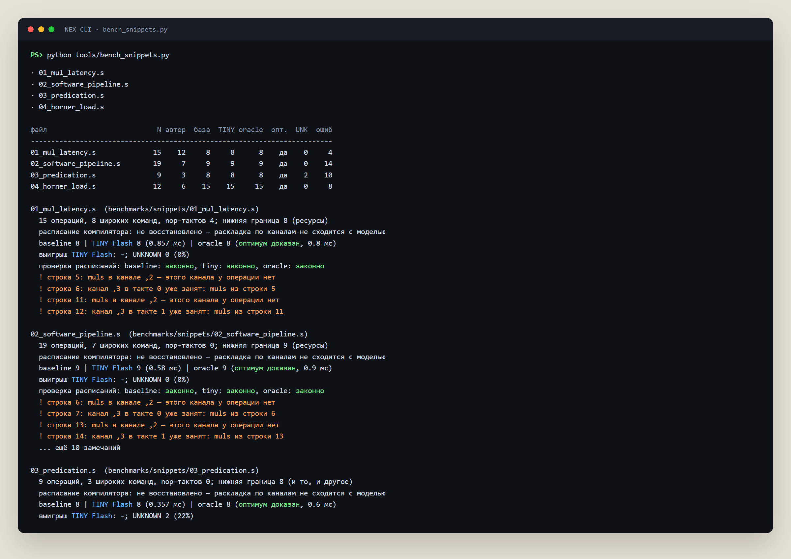
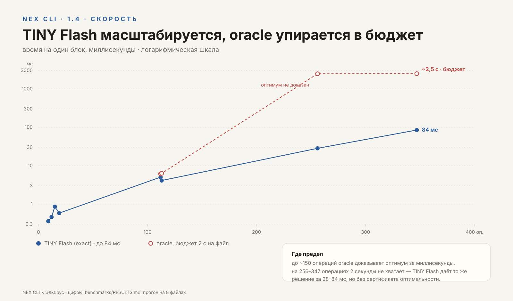
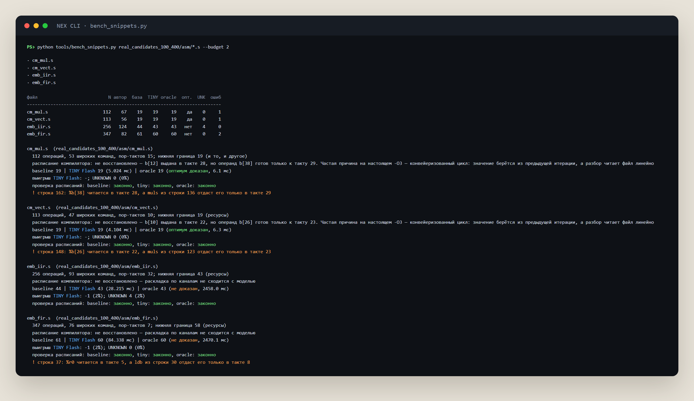

# NEX CLI 1.4 — что нового

**Автор:** Shokha Mir ([@smworklair](https://github.com/smworklair))  
**Дата:** 11 ноября 2026  
**Репозиторий:** [smworklair/NEX-CLI-x-Elbrus](https://github.com/smworklair/NEX-CLI-x-Elbrus)

Коротко: проект перешёл на версию **1.4**, быстрый планировщик переименован в
**TINY Flash**, документация собрана в маршрут из 13 этапов, лицензия закреплена
как «бесплатно для обучения и личного использования», описание NNL приведено
к тому, что реально работает, и добавлены графики и бейчмарк: рукописные
фрагменты и настоящие блоки e2k.

## 1. TINY Fast → TINY Flash

Переименование не косметическое: имя класса, короткое имя и все места вызова
теперь совпадают с тем, что видит пользователь.

- класс `TinyFlashScheduler` в `vliw/tiny/fast.py`, `short = "tiny-flash"`;
- старое имя `TinyFastScheduler` оставлено алиасом — внешние импорты не ломаются;
- панель **НЕЙРОСЕТИ** в РАЗБОРе показывает **TINY Flash**;
- ядро `nex_core` (`архитектуры/планировщик.py`) считает через быстрый вариант;
- команда `python -m vliw tiny` и факты агента (`vliw/agent/context.py`,
  `vliw/ai_hints.py`) тоже переведены на него.

Что это даёт: тот же makespan, что у полного TINY, но до **26 раз** быстрее —
на `eval_hard` 2,6 мс против 63,4 мс на граф. На 3 061 графе расхождений по
makespan — 0, расписания законны. На настоящем коде это 0,6 мс на блок.

Добавлен тест совместимости: `TinyFastScheduler is TinyFlashScheduler`.

## 2. Документация — маршрут вместо набора файлов

Документация разложена на три уровня:

1. **Понять** — `README.md`;
2. **Запустить** — `QUICKSTART.md` → `docs/CLI.md`;
3. **Разобраться** — 13 этапов, от `docs/METHOD.md` до `docs/ENTHUSIAST.md`.

Добавлен `docs/METHOD.md` — методика и границы модели на один экран: что
считается, чего модель не умеет, почему такты модельные. Нумерация всех
документов сдвинута с 12 на 13 этапов.

Исторические документы не удалены: они лежат в `docs/archive/`, а
`docs/archive/README.md` помечен как конец маршрута. Старая инфографика
`speed.png` тоже перенесена в архив.

## 3. Лицензия

Зафиксировано явно, в `README.md`, `pyproject.toml`, `CONTRIBUTING.md` и
`docs/METHOD.md`:

- обучение и личное использование — **бесплатно**;
- корпоративное и коммерческое использование — **по отдельному соглашению
  с автором**.

Бейдж в README: «лицензия: некоммерческая».

## 4. NNL без прикрас

Описание NNL разделено на две части, чтобы не выдавать эксперимент за продукт:

- **рабочий путь** — `nex_core/` и блок помощи; он вызывается из CLI и
  проверяется тестами;
- **эксперименты** — `nnl_vliw/` и `nnl_isa/`; в CLI не включены.

Честно сказано и о качестве: блоки собираются и проходят линтер, но выбор
группы слабый, а перекрёстная проверка не лучше случайного отказа. Для боевого
пути (`TinyFlashScheduler`) это не нужно.

## 5. Новая инфографика

Вместо несгенерированной картинки `speed.png` сделана редактируемая
`docs/img/readme/speed.svg`: сравнение TINY AI и TINY Flash, 63,4 мс против
2,6 мс, ×26. SVG проверен рендером в headless Chrome.

Для заметок о релизе собраны ещё четыре картинки в `docs/img/release/`:
два графика в SVG и два скриншота терминала в PNG. Они вставлены в разделы 6 и 7.

## 6. Бейчмарк фрагментов e2k

Добавлен `benchmarks/` — четыре рукописных фрагмента и прогон по трём
планировщикам:

```bash
python tools/bench_snippets.py
```

<p align="center">
  
</p>

*Рис. 1. Слева — рукописные фрагменты, справа — настоящие блоки. Синяя точка —
TINY Flash, светлое кольцо — жадный baseline, ромб — oracle. На фрагментах все
три совпадают: улучшать нечего. На `emb_iir` и `emb_fir` TINY Flash снимает по
такту, но oracle не доказывает оптимум за 2 секунды.*

| файл | N | как написано | baseline | TINY Flash | oracle | UNKNOWN |
|---|---:|---:|---:|---:|---:|---:|
| `01_mul_latency.s` | 15 | 12 | 8 | 8 | 8 | 0 |
| `02_software_pipeline.s` | 19 | 7 | 9 | 9 | 9 | 0 |
| `03_predication.s` | 9 | 3 | 8 | 8 | 8 | 2 |
| `04_horner_load.s` | 12 | 6 | 15 | 15 | 15 | 0 |

Точный поиск доказал оптимум на всех четырёх. TINY Flash не улучшил makespan:
жадный уже попадает в нижнюю границу — на 9–19 операциях улучшать нечего.

Что показал линтер:

- `muls,2` в 01–03 — недопустимый канал: умножение живёт на `,0 ,1 ,3 ,4`;
- рукописные расписания 02–04 короче законного минимума (7→9, 3→8, 6→15),
  потому что результат читается раньше готовности;
- в `04` загрузка имеет латентность 5 тактов, а её результат читается в такте 1;
- `cmples`/`cmpgts` в 03 — неизвестные мнемоники, 22% операций попали в
  `UNKNOWN` с заглушкой «латентность 1, любой канал».

<p align="center">
  
</p>

*Рис. 2. Тот же прогон в терминале: сверху сводка, ниже — разбор по файлам и
замечания линтера о незаконных расписаниях.*

Отчёты: `benchmarks/results.json`, `benchmarks/results_real.json` и
`benchmarks/RESULTS.md` — там оба набора, фрагменты и настоящие блоки.

## 7. Настоящие блоки 112–347 операций

Кроме рукописных фрагментов, прогнаны четыре блока из
`real_candidates_100_400/asm/` — уже не игрушечные 9–19 операций:

| файл | N | baseline | TINY Flash | oracle | оптимум | время TINY |
|---|---:|---:|---:|---:|---|---:|
| `cm_mul.s` | 112 | 19 | 19 | 19 | доказан | 5,0 мс |
| `cm_vect.s` | 113 | 19 | 19 | 19 | доказан | 4,1 мс |
| `emb_iir.s` | 256 | 44 | **43** | 43 | не доказан за 2 с | 28 мс |
| `emb_fir.s` | 347 | 61 | **60** | 60 | не доказан за 2 с | 84 мс |

Все 12 расписаний (baseline, TINY Flash и oracle на четырёх файлах) законны.
На 256 и 347 операциях TINY Flash снимает по такту — 2% — и повторяет лучший
результат oracle, но сам oracle за 2 секунды оптимум не доказывает: сертификата
оптимальности нет. На 112–113 операциях оптимум доказывается за ~6 мс.

<p align="center">
  
</p>

*Рис. 3. Логарифмическая шкала времени на блок: TINY Flash растёт до 84 мс на
347 операциях, oracle упирается в бюджет 2 секунды.*

<p align="center">
  
</p>

*Рис. 4. Прогон на настоящих блоках: те же цифры, что в таблице, плюс
замечания линтера — в `cm_mul` и `cm_vect` он видит конвейеризованный цикл.*

## 8. Проверки

- полный прогон: **727 тестов, 5 пропущено, OK**;
- `python -m vliw --version` → `NEX CLI 1.4 (1.4)`;
- ссылки в документации: 151 проверена, битых 0;
- все `` в `README.md` существуют.

## 9. Пуш без установленного Git

На машине не было Git, поэтому релиз 1.4 опубликован через GitHub REST API
(Git Data: blob → tree → commit → ref). Автор и коммиттер — аккаунт
`smworklair`. Ветка `main` обновлена без force. Файлы `training/checkpoints/`
при этом не тронуты.

---

*Документ подготовлен в рамках релиза 1.4 и подписан автором проекта.*  
**Shokha Mir** · [@smworklair](https://github.com/smworklair)
