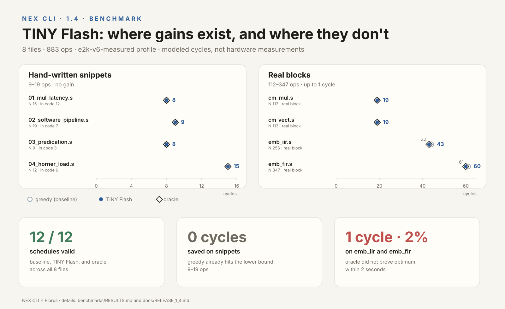
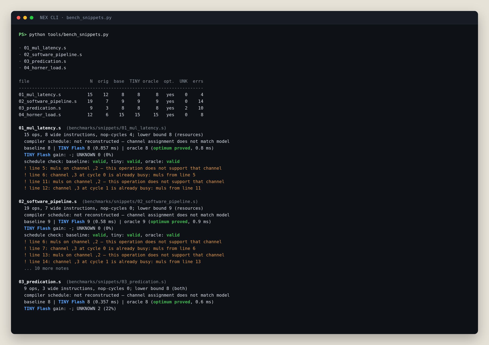
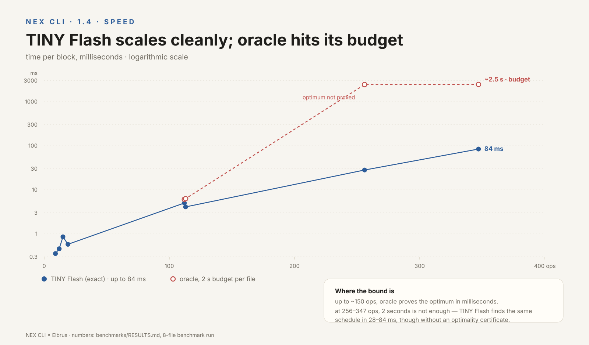
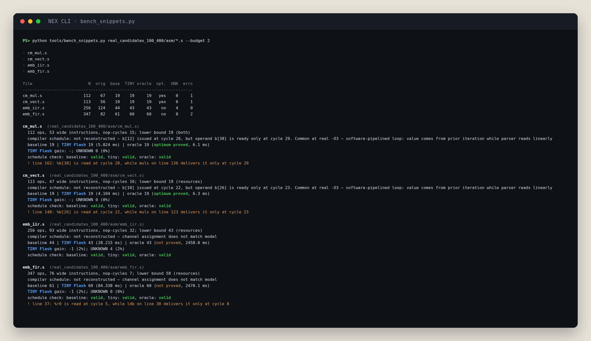

# NEX CLI 1.4 — What's New

**Author:** Shokha Mir ([@smworklair](https://github.com/smworklair))  
**Date:** November 11, 2026  
**Repository:** [smworklair/NEX-CLI-x-Elbrus](https://github.com/smworklair/NEX-CLI-x-Elbrus)

In short: the project bumped to version **1.4**, the fast scheduler was renamed to **TINY Flash**, documentation was organized into a 13-stage roadmap, the license was formalized as "free for educational and personal use", the NNL description was aligned with what actually runs, and new charts plus a benchmark suite (handwritten snippets and real `e2k` blocks) were added.

## 1. TINY Fast → TINY Flash

The rename is not merely cosmetic: class name, short name, and every call site now match what the user sees.

- class `TinyFlashScheduler` in `vliw/tiny/fast.py`, `short = "tiny-flash"`;
- old name `TinyFastScheduler` kept as an alias so external imports do not break;
- the **NEURAL NETS** panel in LAB displays **TINY Flash**;
- the `nex_core` core (`архитектуры/планировщик.py`) runs through the fast variant;
- `python -m vliw tiny` and agent facts (`vliw/agent/context.py`, `vliw/ai_hints.py`) were switched over as well.

What it delivers: the exact same makespan as full TINY, up to **26×** faster — 2.6 ms vs. 63.4 ms per graph on `eval_hard`. Across 3,061 graphs: 0 makespan discrepancies, all schedules valid. On real code, 0.6 ms per block.

Added a compatibility test: `TinyFastScheduler is TinyFlashScheduler`.

## 2. Documentation — A Roadmap Instead of a Pile of Files

Documentation is organized into three levels:

1. **Understand** — `README.md`;
2. **Run** — `QUICKSTART.md` → `docs/CLI.md`;
3. **Dive deeper** — 13 stages, from `docs/METHOD.md` to `docs/ENTHUSIAST.md`.

Added `docs/METHOD.md` — methodology and model boundaries on one screen: what is computed, what the model lacks, and why cycles are model-based. All stage numbers shifted from 12 to 13.

Historical documents were preserved in `docs/archive/`, with `docs/archive/README.md` marking the end of the roadmap. The old `speed.png` graphic was archived as well.

## 3. License

Stated explicitly in `README.md`, `pyproject.toml`, `CONTRIBUTING.md`, and `docs/METHOD.md`:

- educational and personal use — **free**;
- corporate and commercial use — **by separate agreement with the author**.

README badge: "license: non-commercial".

## 4. NNL Without Hype

The NNL description is split cleanly so experiments are never presented as production features:

- **active path** — `nex_core/` and the help block; invoked by the CLI and covered by tests;
- **experiments** — `nnl_vliw/` and `nnl_isa/`; not wired into the CLI.

Quality is stated plainly: the blocks assemble and pass the linter, but portfolio group selection is weak and cross-core validation is no better than random abstention. The production path (`TinyFlashScheduler`) does not need them.

## 5. New Infographics

Replaced the missing `speed.png` with an editable `docs/img/readme/speed.svg`: TINY AI vs. TINY Flash, 63.4 ms vs. 2.6 ms, 26×. SVG verified by rendering in headless Chrome.

Four additional visuals for the release notes live in `docs/img/release/`: two SVG charts and two PNG terminal screenshots, embedded in Sections 6 and 7 below.

## 6. `e2k` Snippet Benchmark

Added `benchmarks/` — four handwritten snippets evaluated across three schedulers:

```bash
python tools/bench_snippets.py
```

<p align="center">
  
</p>

*Fig. 1. Left: handwritten snippets; right: real blocks. Blue dot = TINY Flash, light ring = greedy baseline, diamond = oracle. On snippets all three coincide: nothing left to improve. On `emb_iir` and `emb_fir`, TINY Flash shaves 1 cycle each, though the oracle cannot prove optimality within 2 seconds.*

| file | N | as written | baseline | TINY Flash | oracle | UNKNOWN |
|---|---:|---:|---:|---:|---:|---:|
| `01_mul_latency.s` | 15 | 12 | 8 | 8 | 8 | 0 |
| `02_software_pipeline.s` | 19 | 7 | 9 | 9 | 9 | 0 |
| `03_predication.s` | 9 | 3 | 8 | 8 | 8 | 2 |
| `04_horner_load.s` | 12 | 6 | 15 | 15 | 15 | 0 |

Exact search proved optimality on all four. TINY Flash did not shorten makespan because greedy already hits the lower bound — at 9–19 operations there is no headroom left.

What the linter caught:

- `muls,2` in 01–03 is an invalid channel: multiply executes on `,0 ,1 ,3 ,4`;
- handwritten schedules 02–04 are shorter than the valid minimum (7→9, 3→8, 6→15) because results are read before they are ready;
- in `04`, load latency is 5 cycles, yet its result is consumed in cycle 1;
- `cmples`/`cmpgts` in 03 are unknown mnemonics, placing 22% of ops into `UNKNOWN` ("latency 1, any channel").

<p align="center">
  
</p>

*Fig. 2. Terminal output from the same run: summary on top, per-file breakdown and linter diagnostics for invalid schedules below.*

Reports: `benchmarks/results.json`, `benchmarks/results_real.json`, and `benchmarks/RESULTS.md` covering both sets (snippets and real blocks).

## 7. Real Blocks of 112–347 Operations

Alongside the handwritten snippets, four real blocks from `real_candidates_100_400/asm/` were benchmarked — well beyond toy 9–19 op sizes:

| file | N | baseline | TINY Flash | oracle | optimum | TINY time |
|---|---:|---:|---:|---:|---|---:|
| `cm_mul.s` | 112 | 19 | 19 | 19 | proven | 5.0 ms |
| `cm_vect.s` | 113 | 19 | 19 | 19 | proven | 4.1 ms |
| `emb_iir.s` | 256 | 44 | **43** | 43 | unproven in 2 s | 28 ms |
| `emb_fir.s` | 347 | 61 | **60** | 60 | unproven in 2 s | 84 ms |

All 12 schedules (baseline, TINY Flash, and oracle across all four files) are valid. At 256 and 347 operations, TINY Flash saves 1 cycle each (~2%) and matches the oracle's best incumbent, though the oracle itself does not finish proving optimality within 2 seconds. At 112–113 operations, optimality is proven in ~6 ms.

<p align="center">
  
</p>

*Fig. 3. Log-scale time per block: TINY Flash scales to 84 ms at 347 operations while the oracle hits its 2-second budget.*

<p align="center">
  
</p>

*Fig. 4. Real-block run: same figures as the table, plus linter findings — in `cm_mul` and `cm_vect` it detects a software-pipelined loop.*

## 8. Verification

- full test suite: **727 tests, 5 skipped, OK**;
- `python -m vliw --version` → `NEX CLI 1.4 (1.4)`;
- documentation links: 151 checked, 0 broken;
- all `` paths in `README.md` exist.

## 9. Publishing Without Local Git

Git was not installed on the release machine, so release 1.4 was published via the GitHub REST API (Git Data: blob → tree → commit → ref). Author and committer: `smworklair`. Branch `main` updated without force-push. Files under `training/checkpoints/` were left untouched.

---

*Prepared for release 1.4 and signed by the project author.*  
**Shokha Mir** · [@smworklair](https://github.com/smworklair)
