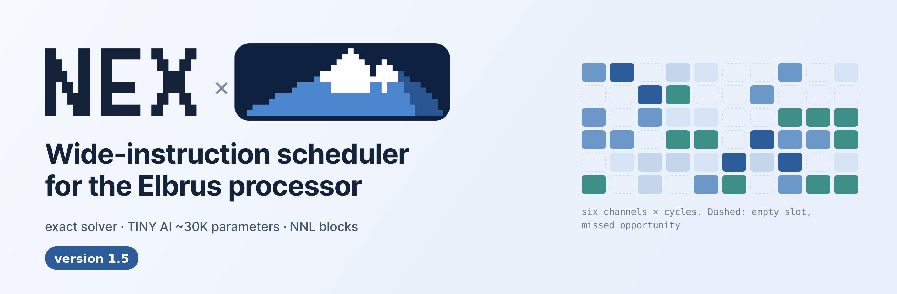
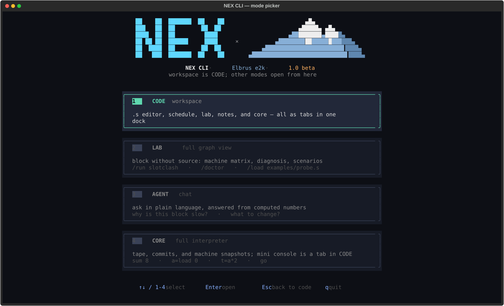
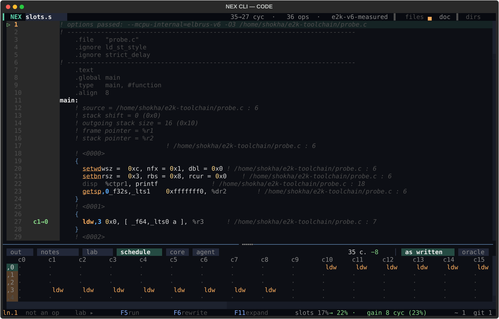
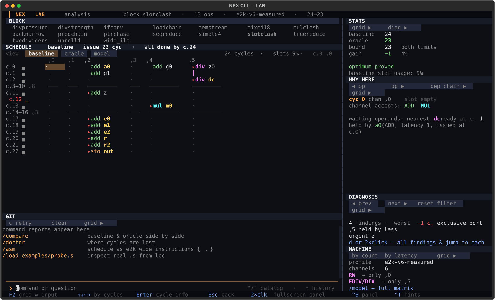

> This is the full README with all details. The short version is in the [repository root](../../README.md).

<p align="center">
  
</p>

<p align="center">
  <b>Exact schedule computation for VLIW (Elbrus e2k)</b> · TINY AI ~30K parameters · modular NNL architecture
</p>

<p align="center">
  
  
  
</p>

> ### Current version: 1.3.1 (10.11.2026)
> **TINY AI** builds block schedules and honestly never makes them worse than baseline. The NEX core
> (`nex_core/`) has been merged into main: a single NNL "scheduler" block instead of a direct TINY AI call.
> Verify: `python3 -m vliw --version` → `NEX CLI 1.3`.

## In Brief

NEX CLI computes wide-instruction schedules for Elbrus on a calibrated machine model and compares them
against a proven optimum. **TINY AI** (networks of ~30k weights, formerly "tiny schedulers") chooses the
order and deferrals for placing operations; **the schedule is legal by construction** because a
deterministic scheduler assembles it while the network only suggests the order. NNL (Neural Network Lego)
is a separate modular block architecture being tested here on processor tasks; for now it runs in the
background and does not build schedules.

## What's New

| Version | What it delivered | Numbers |
|---|---|---|
| **1.3.1** (current) | **TINY AI builds schedules.** The NEURAL NET panel in LAB shows what tiny achieved plus `.s` block breakdown (NNL AI removed from CLI — it was redundant); safe glyphs and UTF-8 in the Windows console | model cycles; on real code the tiny gain is small — see [`CHANGELOG.md`](../../CHANGELOG.md) |
| | **NEX Core.** Single NNL "scheduler" block (TINY AI + lower-bound rule), passport and weights with sha256 verification; NEURAL NET panel and agent pull schedules from the core | matches direct TINY AI calls on all scenarios; tampered weights are rejected |
| **1.2 beta** | **NNL on a processor task.** Two cores of two blocks each select a portfolio group and cross-check each other | works technically, quality on par with ordinary classifiers, not enabled in the production path — see [`nnl_vliw/README.md`](../../nnl_vliw/README.md) |
| **1.1.1 beta** | **Fast tiny schedulers (TINY Fast).** `TinyFastScheduler` gives the exact same result as `TinyScheduler`, dozens of times faster: every code block can be scheduled on the fly | `eval_real` graph: 70.4 → 0.95 ms; `eval_hard`: 63.4 → 2.6 ms; 0 mismatches against prior output on 3,061 graphs |
| | **Block mode.** Real `.s` from `lcc` is split into basic blocks, each scheduled separately as the compiler does | `eval_real`: 947 real blocks with proven optima |
| | **First check on real code** | optimal: greedy 890, TINY AI 927 of 947; greedy loses 0.51% of cycles |

These are model cycles, not hardware measurements; `loop_mode` (hardware loop pipelining) is not yet modeled.

## Where to Look Next

- [`docs/TINY_FAST.md`](TINY_FAST.md) — where the speed came from;
- [`docs/ISA.md`](../ISA.md) — what `e2k-v6` operations cost;
- [`docs/REAL_VS_SYNTH.md`](../REAL_VS_SYNTH.md) — real code vs. synthetic (written 29.08; part of the vocabulary gap has since been closed);
- [`nnl_vliw/README.md`](../../nnl_vliw/README.md) — NNL cores on the scheduling task;
- [`CHANGELOG.md`](../../CHANGELOG.md) — version history.

---

# VLIW Instruction Scheduler (Elbrus e2k)

A prototype for the research project "AI Instruction Scheduler for VLIW Architectures" —
though what is actually worth using and works here is not a trained model, but exact
computation on a calibrated machine model. Core thesis of the project:

> **a wide-instruction scheduler makes greedy, irreversible decisions, and on a realistic
> machine model the standard heuristic has a measurable, provable gap to the optimum —
> that gap is the budget worth fighting for with a trained model.**

The AI track exists and works in this project (trained, weights published), but the
outcome of that fight is negative and is not hidden: details and methodology are in
[What Is Measured Here](#what-is-measured-here) below.

Runs on plain Python 3.10+. Neither `lcc`, nor `qemu-e2k-static`, nor LLVM is needed
or invoked here. The only **optional** dependency is `rich` (see
[below](#about-optional-dependencies)); without it, everything works in full over ANSI.

**One mode, two ways to invoke.** With no arguments — logo, default output, and
interactive loop; with a command — single run and exit (fast mode for scripts). The
commands are identical: without `/` outside, with `/` inside the loop.

```bash
cd vliw-ai-scheduler-demo      # IMPORTANT: run commands below from the project folder
pip install -e ".[tui]"        # workspace (textual) — intended setup
python3 -m vliw                # workspace: mode picker, then LAB/CODE/AGENT
python3 -m vliw run slotclash  # same, opening directly on the slotclash block
```

`run`, `load`, `compare`, `doctor`, `bounds`, `path`, `analyze` are single-block
commands and open the workspace on that block rather than printing a text report. That
is always how they behave when a terminal is attached and the workspace is installed.

Batch runs over many graphs at once print text — they have nothing to display on a
single screen:

```bash
python3 -m vliw all            # summary across all scenarios
python3 -m vliw scenarios      # list of scenarios
python3 -m vliw sweep          # batch run across random graphs
python3 -m vliw selfcheck      # verify oracle via brute-force search
```

Text output remains available for single-block commands too — it is the path for
scripts, pipes, and CI, not an alternate way to use the tool interactively:
`python3 -m vliw --no-color run slotclash > out.txt` or in redirected output (`| grep`,
no TTY), where the workspace physically cannot open because there is nowhere to open it.

> If you see `No module named vliw`, you are not in the project folder — `cd` first.
> If `python: command not found`, your interpreter is named `python3` (used in all
> examples above). More common issues and a full breakdown of every command are in
> **[docs/CLI.md](../CLI.md)**.
> On Windows — **[docs/WINDOWS.md](../WINDOWS.md)**: installation, `py` instead of
> `python3`, and what to do if AGENT says "no network".

**Workspace in detail, mode by mode:** [CODE](../CODE_MODE.md) — every key and the
explorer; [LAB](../LAB_MODE.md) — the grid and all seven panels;
[CORE](../CORE_MODE.md) — brief, it is a calculator with history;
[prompts for AGENT](../AGENT_PROMPTS.md) — ready-made questions and an honest caveat on
answer accuracy. Full documentation index, including the research journal —
**[docs/README.md](../README.md)**.

**Want to dig into the code, not just use it** — start with
[docs/ENTHUSIAST.md](../ENTHUSIAST.md): what you can change in the UI, how to train your
own model, how to write scripts — and honestly what is closed and why.

## Development Setup

```bash
git clone <your-fork-url> vliw-ai-scheduler
cd vliw-ai-scheduler
pip install -e ".[tui]"   # core works without extras too; TUI needs them
python -m unittest discover -s tests
```

Short English start in [QUICKSTART.md](../../QUICKSTART.md), contributor rules in
[CONTRIBUTING.md](../../CONTRIBUTING.md).

## What Is Measured Here

The sole metric is **cycle count** (makespan) on the exact same dependency DAG and the
exact same machine model:

| | |
|---|---|
| **baseline** | greedy list scheduler prioritized by remaining critical-path length — what real compilers use (`kind="heuristic"`) |
| **oracle** | exact search (iterative-deepening branch-and-bound) — a practically unreachable theoretical *ceiling* (`kind="exact"`) |

**On terminology.** The oracle is NOT "AI" and not a trained model, but exact
mathematical optimal search. A trained model (LoRA on top of Qwen2.5-3B, weights on
[Hugging Face](https://huggingface.co/Shmonika/nex-vliw-lora), runner in
[`vliw/learned/`](../../vliw/learned/README.md)) exists and runs in this project, but
the benchmark result is negative and is not hidden: on real `lcc` output (graphs of
112–386 nodes), the model did not beat plain random search on a single graph out of 13,
total +0 cycles (methodology and `VERIFY.sh` in
[`real_candidates_100_400/model_eval/`](../../real_candidates_100_400/model_eval/REPORT.md)).
The oracle remains the upper quality bar and source of reference schedules regardless of
how the model behaves.

## Results

```
  scenario      N  model            lower_b.  baseline  oracle  gain     optimum
  simple4       7  e2k-v6-measured        13        13      13  —        proven
  loadchain    16  e2k-v6-measured        12        12      12  —        proven
  mixed18      19  e2k-v6-measured        23        23      23  —        proven
  slotclash    13  e2k-v6-measured        22        23      22  -1 (4%)  proven
  mulclash     12  e2k-v6-measured        21        21      21  —        proven
  divpressure  19  e2k-v6-measured        14        20      20  —        proven
  wide_ilp     63  e2k-v6-measured        11        13      13  —        not proven
  memstream    24  e2k-v6-measured         7        11      10  -1 (9%)  proven
```

> **These numbers are the second edition.** The first version of the model was wrong,
> and the README showed completely different figures (`slotclash −9 cycles, 22%`,
> `mulclash −7, 21%`). Post-mortem of the error is in
> [How the Model Turned Out to Be Wrong](#how-the-model-turned-out-to-be-wrong-and-what-that-changes)
> below; it matters more than the numbers themselves.

Two conclusions, both important and both honest:

**1. The heuristic does have a gap, but it is small, and its source is a single thing —
a scarce port.** There is only one truly monopoly execution unit on `e2k`: the divider
(port `,5`; the assembler refuses to encode `sdivs` anywhere else). Plus stores are
scarce — they encode only in `,2` and `,5`. A greedy scheduler is work-conserving: if a
scarce port is free and some operation for it is ready, it issues it — even when nobody
needs the result urgently. `slotclash` catches this on the divider; `memstream` catches
it on the store channel. Both gaps are 1 cycle and both are proven by exact search; the
honest scale of the problem is single-digit percent, not tens of percent.

**2. The size of the gap is almost entirely determined by how accurately the machine is
described — and this is testable.** `python3 -m vliw sweep` runs random graphs across
all machine configurations, including the **refuted first version of the model**, kept
in the project specifically for this comparison (below is `sweep --seeds 20 --sizes
10,12,14`, 60 graphs per row):

```
  model                 ch.  slots          with gap  share  mean gap  max, cycles
  e2k-v6-measured         6  asymmetric         1/60     2%        3%            1
  e2k-v6-measured/w4      4  asymmetric         1/60     2%        3%            1
  e2k-v6-measured/w3      3  asymmetric         1/60     2%        3%            1
  e2k-v6-firstprobe       6  asymmetric         4/60     7%       18%           15
  e2k-v6-firstprobe/w4    4  asymmetric         4/60     7%       18%           15
  e2k-v6-firstprobe/w3    3  asymmetric         6/60    10%       12%            9
  naive_homogeneous       6  symmetric          0/60     0%         —            —
  naive_homogeneous/w4    4  symmetric          0/60     0%         —            —
  naive_homogeneous/w3    3  symmetric          0/60     0%         —            —
```

Read it like this: on the **wrong** model (`firstprobe`, where a monopoly was wrongly
attributed to the multiplier), the greedy heuristic "loses" on 7% of graphs by 18% of
cycles. On the **verified** model — on 2% of graphs by 3%, at most 1 cycle. On the
"all ports equal" model — it never loses at all. In other words, most of "the gap worth
fighting for with a trained model" existed not in silicon, but in a modeling error.

The mechanism of the remaining gap is visible on `slotclash` (23 cycles vs. 22 optimal):

- the dead-end division `z0` is independent and ready at cycle 0, but nobody needs its
  result urgently; the critical division `dc` waits on its operand `a0` and is only
  ready at cycle 1;
- at cycle 0 the heuristic sees a free divider and a ready `z0` — and occupies the sole
  divider with it;
- critical `dc` is pushed back as a result: the divider accepts a new division once
  every two cycles, shifting the entire critical path;
- the optimum holds the divider, gives it to `dc`, and computes `z0` later in the shadow
  of the critical chain.

The underlying mechanism is general: critical-path priority sees chain lengths and is
blind to the fact that a scarce port must not be spent on work nobody is waiting for.
Yet the honest scale of this problem on the verified model is single cycles, and
pretending it is tens of percent is unacceptable.

## How the Model Turned Out to Be Wrong (and What That Changes)

The only section of the README written by date and in the first person. The rest of the
document describes what is in the project. What matters here is the order in which I
understood it, because the wrong machine model lived for two weeks, looked like a
result, and produced attractive numbers.

**August 17.** The machine model was built from ONE `lcc -O3 -S` listing for `probe.c`:
four independent divisions, four multiplications. All four `muls` landed in channel `,0`
one after another. I read that as "e2k has one multiplier and it holds the port for 8
cycles". From there came the `mulclash` scenario, "21% gap", and the entire "two
monopolies" storyline. A 21% gap is hard to come by, and I didn't want to double-check
it.

**August 29–31.** Checked the way I should have from the start: not from compiler
output, but from the assembler itself and probes designed for the question.

- **Eight independent multiplications** instead of four — the compiler itself placed
  `muls,0` and `muls,1` **in the same wide instruction**. That alone falsifies "there
  is one multiplier".
- **Sixteen independent multiplications** issue one per cycle back-to-back with no
  gaps — meaning the unit is pipelined and the port is free on the very next cycle.
- **The assembler answers directly** once you finally ask it rather than the scheduler:
  `$LCC -c` on a `.s` with `muls,2` prints `Error: 'muls' cannot be encoded in ALC2`.
  Sweeping all six channels yielded the matrix: `muls` — `,0 ,1 ,3 ,4`, `sdivs` — `,5`
  only, `stw` — `,2 ,5` only, `ldw` — `,0 ,2 ,3 ,5`.

Latencies taken by the same unreliable method fell apart at the same time. Chains of
DEPENDENT operations (which the compiler must space by exact latency) gave MUL **4**
cycles instead of 8, DIV **11** instead of 13, LOAD **5** instead of 2. Streams of
INDEPENDENT operations gave issue rates: MUL — every cycle, DIV — once every two
cycles, not "holds the port for 13 cycles".

I did not like this. Every number the project had been boasting about turned out to be
the consequence of a single sloppy glance — not thirteen separate bugs that could be
fixed one by one.

**What to take away from this even if you don't care about Elbrus:** compiler output
shows what the compiler CHOSE to do, not what the hardware CAN do. A greedy scheduler
will not occupy a second channel when the first one is enough — and an observer mistakes
that for a physical limit.

**What was done, not merely admitted:**

- `vliw/core/model.py` was repopulated from verified data, with a source tag on every
  parameter (`verified by assembler` / `dependent chain` / `independent stream` /
  `assumption`) — visible in `/model`;
- the erroneous model was **kept** as profile `e2k-v6-firstprobe` so the difference can
  be seen rather than just read: `/model e2k-v6-firstprobe`;
- the `mulclash` scenario was not deleted, but rewritten: it is now an exhibit in the
  "model check" group — no gap on the verified model, gap on `firstprobe`;
- the probes and **real** compiler output are stored in
  [`examples/probes/`](../../examples/probes/README.md) along with the methodology;
- the old hand-drawn "illustration" `examples/probe.s` made for the wrong model is
  marked as an exhibit (`probe_ILLUSTRATION_OBSOLETE.s`) and replaced with real `lcc`
  output.

The wrong profile stays in the project intentionally. This kind of error is easy to
describe in words and impossible to feel until you see with your own eyes how the exact
same fifteen operations produce different answers under two profiles.

**Boundary of applicability found in the same place.** `wide_ilp` has 63 instructions;
exact search exceeds budget and falls back to portfolio search. It found nothing better
than baseline, nor did it prove optimality. The report states exactly that — not "no
gap", but "no gap found".

The full dated journal — with everything that didn't fit in the README: the empty eval,
the CAB portfolio, two bugs along the way — is in **[docs/JOURNAL.md](JOURNAL.md)**.

## Beyond the Scheduler: Optimization Techniques

Everything above is about the SCHEDULER's job: one DAG, two layouts, the gap between
them. On `e2k`, however, losses more often come from elsewhere: the scheduler has
already squeezed everything out, yet cycles are still lost because of the code itself.
The second half of the scenarios (`/scenarios`, groups "graph shape", "operation cost",
"loops", "memory", "branches") is built as "as written" → "as it should be" pairs:

```
  scenario      N  lower_b.  baseline  oracle  gain     what it shows
  seqreduce    16        13        13      13  —        acc += v[i]: chain, ILP = 1
  treereduce   16         9        10      10  —        same reduction as a tree
  divpressure  19        14        20      20  —        4 divisions on sole ,5
  divstrength  19         4         5       5  —        same 4 ops via shift
  unroll4      12        12        12      12  —        unrolling works, memory blocks it
  ptrchase     23        32        32      32  —        p = p->next: memory chain
  memstream    24         7        11      10  -1 (9%)  store lives only in ,2 and ,5
  ifconv       13         9         9       9  —        both branches computed
```

The "gain" column is empty almost everywhere — and that is the exact point: **exact
search gives nothing because the code needs optimizing, not the schedule.** The point
is comparing ADJACENT rows, not baseline against oracle:

- `seqreduce` → `treereduce`: same instruction count, 13 cycles vs. 10. Reduction into
  a single accumulator cannot be parallelized in principle; reassociation in the source
  helps (for floating point, only explicitly, since it changes rounding order).
- `divpressure` → `divstrength`: 20 cycles vs. 5. Division is the machine's sole true
  monopoly: port `,5`, a new division once every two cycles, result in eleven. Replacing
  it with a shift (or hoisting a reciprocal out of a loop) wins more than any scheduler
  improvement.
- `unroll4`: unrolling genuinely works — multiplications fan out across four channels
  without interfering. The block is held back not by arithmetic, but by 5-cycle load
  latency: hoisting loads earlier wins, not another unroll factor.
- `ptrchase`: 32 cycles across six dependent loads — the longest block in the suite, and
  no scheduler can shorten it: the next load's address is only known after the previous
  one completes.
- `memstream`: the only scenario in this group with a gap. The cause is not compute —
  stores encode in only two channels (`,2` and `,5`), and the heuristic spends the
  scarce slot in the wrong order.
- `ifconv`: speculatively computing both branches of a condition is free as long as they
  use general-purpose ops; put a division in there and you get `slotclash`.

The numbers in the table are computed live by the tool (`python3 -m vliw all`), not
hardcoded in prose.

## Interactive Mode

One screen with docked panels, IDE-style: an `e2k` assembly editor on the left, live
schedule analysis right in the line numbers, and bottom tabs (schedule, findings,
output, core). Opens with `python3 -m vliw` with no arguments — starting at the mode
picker:



Next is the CODE workspace, analyzing a real `.s` from `lcc`:



The same screen as text if images do not load:

```
▍NEX  slots.s ✕  probe.s ✕                 15→8 c. · 15 ops · e2k-v6-measured
    11  c0     muls,0 %r10, %r11, %r20
──────────────────────────────────────────────────────────────────────────────
  schedule     lab        findings    output   core     15 c. −7  as written    oracle
    c0      c1      c2      c3      c4
 ,0  muls    muls    muls    muls    muls
  F5 run        F6 rewrite      F12 dock  ^P command   ^G ask
```

The other screens — LAB (full DAG, cycles×channels grid, diagnosis), AGENT (dialog),
and fullscreen CORE (interpreter workbench) — open via `/clear` or `^O` and return via
`Esc`:



**Each screen is documented separately, button by button:**
[CODE](../CODE_MODE.md) — editor, explorer, all dock tabs, and the F6 caveat;
[LAB](../LAB_MODE.md) — the grid and all seven panels;
[CORE](../CORE_MODE.md) — brief, it is a calculator with history. Full CLI
documentation (commands, flags, Tab completion, history, troubleshooting) —
[docs/CLI.md](../CLI.md).

### About Optional Dependencies

The project has no required dependencies. **All functionality — color, borders,
replay, interactive loop, analysis, and diagnostics — runs on plain ANSI and the
standard library.** Two packages are optional:

| package | what it adds | without it |
|---|---|---|
| `textual` | three fullscreen modes: interpreter workbench, interactive schedule grid, dialog with trace | helper screen with reason, plan, and `pip install` command; one-shot commands and `--plain` work |
| `rich` | panels around prominent report blocks | the same blocks with ANSI borders |

First launch without `textual` is neither a dead end nor a help dump. A helper screen
opens: it explains why, accepts a plain-language request or arrow-key selection, shows
a plan with exact commands, and after confirmation installs the missing packages and
opens the workspace. Deletion and other irreversible steps are never executed by the
helper — it only shows the commands. `--plain` remains the explicit way to work
line-by-line.

If [`rich`](https://github.com/Textualize/rich) is installed in the environment,
prominent blocks (logo, verdict, help panels) are additionally framed with its panels —
purely cosmetic, with automatic graceful fallback if the library is absent:

```bash
pip install rich    # the only optional dependency, not required
```

## Machine Model Calibration

The numbers were obtained experimentally: test `.c` files with independent operations
were compiled with the cross-compiler `lcc-1.29.16 -O3 -fverbose-asm -S` (target
`e2k-v6`) and run under `qemu-e2k-static`; then the emitted wide instructions in `.s`
were inspected. Latencies are visible from bundle-number deltas — the compiler encodes
delays with explicit `nop N`, making timings readable without public ISA documentation.

### Port capability matrix — asked of the assembler

Reading compiler listings and drawing conclusions about hardware is **unreliable**: you
see what the scheduler chose to do, not what the machine can do (that is literally how
the [first-version error](#how-the-model-turned-out-to-be-wrong-and-what-that-changes)
happened). So the matrix is extracted differently: for every `(operation, channel)`
pair, a tiny `.s` is assembled and handed to the **assembler**. If illegal, we get a
direct rejection:

```
Error: `muls' cannot be encoded in ALC2
```

That is a statement about wide-instruction encoding — i.e., about the hardware itself.
Sweeping all six channels for every operation yielded:

| Operation | Channels | Latency | Issue rate | Source |
|---|---|---|---|---|
| `adds`/`subs`/`ands`/`shls` | all six `,0`…`,5` | 1 cycle | 1/cycle | assembler + chain |
| `muls`/`muld` | `,0 ,1 ,3 ,4` (four) | 4 cycles | 1/cycle | assembler + chain |
| `sdivs` | **`,5` only** | 11 cycles | 1 per 2 cycles | assembler + chain |
| `ldw`/`ldd` | `,0 ,2 ,3 ,5` | 5 cycles | 1/cycle | assembler + chain |
| `stw`/`std` | **`,2 ,5` only** | 2 cycles | 1/cycle | assembler + chain + pair probe |

Latencies were measured via **chains of dependent** operations (`x = x * b` in a row:
the compiler must space them by exact latency), and issue rates via **streams of
independent** operations (step between issues). Four `muls` in a single wide instruction
assemble cleanly — there is no "at most two multiplies at once" limit at the encoding
level.

Conclusion baked into the model: `e2k` does not have "six interchangeable ALUs", but a
**capability matrix** mapping port → allowed operations. Yet there is only one true
monopoly in it — the **divider**; the second scarcest resource is store (two channels).
The multiplier is not a bottleneck.

The report prints the source of every parameter so measured values never mix with
guesses. Hence three machine profiles:

- **`e2k-v6-measured`** (default) — matrix verified by the assembler, latencies measured
  from dependent chains. What you should trust.
- **`e2k-v6-firstprobe`** — the **refuted** first version: "sole multiplier on `,0`
  holding the port for 8 cycles", DIV 13/13, LOAD 2. Kept deliberately so you can see
  the difference with your own eyes rather than just read about it:
  `/model e2k-v6-firstprobe`, then `/run slotclash`.
- **`naive_homogeneous`** — degenerate contrast: 6 fully symmetric channels, any
  operation on any channel. Shows the case where port choice is not a decision at all.

The prototype's key result is precisely that *the answer to "is AI needed here" depends
entirely on the port capability matrix*. Previously that parameter was an assumption —
now it is measured, and measurement revealed the exact port monopoly that creates a gap
between heuristic and optimum.

### Operation combinations: a second class of constraints

The port matrix answers "is an operation executable on this channel" — one operation at
a time. The same technique asks about **pairs**: build a wide instruction from two
operations that are each legal on their own and see if the assembler accepts it.
Exhaustive enumeration finds exactly two bans:

```
Error: the combination of STORE in ALC2 with LOAD in ALC3 is prohibited
Error: the combination of STORE in ALC5 with LOAD in ALC0 is prohibited
```

The other 117 combinations are legal — including `STORE,2 + LOAD,0` and
`STORE,5 + LOAD,3`. So the ban is not "store plus load in general", but specifically
these two channel pairs: `(2,3)` and `(5,0)` — the "seams" between clusters `,0 ,1 ,2`
and `,3 ,4 ,5`. **Machine clustering exists and is observable, but manifests as a
structural ban inside a wide instruction rather than as an inter-cluster latency.**

Inter-cluster latency itself **cannot** be measured with a local toolchain, and that is
verified rather than assumed: the assembler does not track register dependencies at all
(a dependent pair in adjacent cycles is silently accepted), and the compiler cannot be
instructed which cluster to place an operation in — channels cannot be chosen from `.c`.
Putting a latency into the model "from documentation" would repeat the exact mistake
that forced us to create the `e2k-v6-firstprobe` profile.

The bans are **not yet wired into the model**, and that is a deliberate ordering of work
rather than an oversight: exact search relies on "a bipartite matching exists ⟺ the set
is issuable in this cycle", and pair bans break that property — changing it requires
modifying the core optimality proof. The gap is guarded by verification itself:
`python -m vliw verify` sweeps pairs on every run and complains if the set of bans
changes. Details in [`examples/probes/README.md`](../../examples/probes/README.md).

## How It Is Structured

The project is split into layers: **logic prints nothing, visualization computes
nothing, glue is thin.**

```
vliw/
  core/            LOGIC (prints nothing, knows nothing about color/rich)
    model.py         machine model: port capability matrix, latencies, monopoly
    dag.py           dependency DAG, test scenarios, lower bounds
    schedule.py      schedule (cycle, port) + full validation
    api.py           Scheduler protocol (contract for all schedulers)
    baseline.py      greedy list scheduler        (kind="heuristic")
    oracle.py        exact search + fallback engine (kind="exact")
    doctor.py        diagnostics: where cycles are lost and why (rules)
    asm_parser.py    parser for real .s from lcc → DAG + compiler schedule
    selfcheck.py     independent brute-force verification of the oracle
  ui/              VISUALIZATION (takes data from core, renders; ANSI + rich)
    render.py        color, width, borders, tables, panels
    theme.py         palette from themes/*.json (roles + op colors)
    themes/*.json    themes themselves: nex-dark (default), classic
    logo.py          pixel NEX banner + Elbrus peak, status bar
    tables.py        tables for scenarios/results/matrix/sweep/selfcheck
    schedule_view.py bundle boxes, verdict, bounds, critical path, breakdown
    context.py       session context panel (also the /status command)
    slash.py         "/" palette: command filtering by group, arg completion
  tui/             FULLSCREEN INTERFACE (Textual; sole fullscreen UI)
    screens/         CODE (workspace) + LAB / AGENT / CORE
    widgets.py       panels, "/" palette, input dock, smart insert
  learned/         TRAINED MODEL: LoRA on Qwen2.5-3B, local execution
    runtime.py       weight discovery, dependencies, llama.cpp server, generation
    scheduler.py     LearnedScheduler(kind="learned") — working implementation
    portfolio.py     CAB: multiple legal schedules from one response
    repair.py        repairing illegal channels in raw model output
    bench.py         benchmark on any .jsonl, decoupled from built-in eval
    README.md        interface, prompt format, HF weights link
  tiny/            TINY SCHEDULERS: working trained scheduler (~21K parameters,
                   pure stdlib inference, milliseconds).
                   Weights live in git (kilobytes, not gigabytes) — unlike
                   learned/, nothing to download. Details & benchmarks —
                   [vliw/tiny/README.md](../../vliw/tiny/README.md), `/tiny` command
  cli.py           SINGLE entry point: command → core → ui → print
  __main__.py      thin: calls cli.main()
docs/
  CLI.md           full CLI documentation: commands, flags, input, troubleshooting
```

All schedulers implement the single `Scheduler` protocol from `core/api.py`, with honest
classification:

```python
GreedyListScheduler   kind = "heuristic"   # baseline
OracleScheduler       kind = "exact"       # exact search (ceiling), NOT "AI"
LearnedScheduler      kind = "learned"     # trained LLM — trained and working
TinyScheduler         kind = "learned"     # tiny: MLP priorities + search,
                                           # legal by construction, see /tiny

    def schedule(self, dag, model) -> SchedulingResult:  # shared contract
        ...
```

Everything else — validation, metrics, explanations, CLI, visualization — works with any
scheduler implementing this method. The trained model already lives in
[`vliw/learned/`](../../vliw/learned/README.md) without modifying `core`/`ui`/`cli` —
that is what the contract was designed for. The oracle remains the upper comparison bar
regardless of how the model behaves.

### Why you can trust the oracle

The oracle declares its schedules optimal — a claim you cannot take on faith: a pruning
bug would produce a "proven optimum" that is not optimal, turning the whole demo into a
rigged show. Therefore `core/selfcheck.py` contains a second, deliberately dumb
scheduler — exhaustive brute-force over all subsets of ready instructions and all
channel assignments, without a single clever prune.

A run across 5,472 problems (random graphs of 5–8 instructions × machines of width 2–3 ×
both profiles) produced zero mismatches: wherever the oracle claims optimality, its
makespan matches brute force, and the lower bound was never above the true optimum. In
addition, every emitted schedule passes validation (dependencies, bundle width, port
capabilities, monopoly occupancy) — checked in the CLI on every run as well.

```bash
python -m vliw selfcheck --seeds 40 --time-limit 120
```

## Prototype Limitations

- The machine model is a toy: no register pressure, speculation, predicates, or memory
  accesses more complex than "load with fixed latency". Real `e2k` is more complex in
  every respect.
- **Intra-bundle operation combination constraints are not in the model — yet the machine
  has them, and they are measured.** The assembler rejects exactly two pairs: store on
  `,2` with load on `,3`, and store on `,5` with load on `,0`. These are the "seams"
  between channel clusters (`,0 ,1 ,2` and `,3 ,4 ,5`). The gap is tracked by a check
  (`python -m vliw verify` prints it on every run), not forgotten —
  [details and why it is not yet in the model](#operation-combinations-a-second-class-of-constraints).
- The port capability matrix was extracted from the assembler and is reliable in that
  scope, but only the operations in the model were probed (`adds`/`subs`/`ands`/`shls`,
  `muls`/`muld`, `sdivs`, `ldw`/`ldd`, `stw`/`std`). The rest of the `e2k` ISA was not
  examined at all.
- Latencies were extracted from the COMPILER, not silicon: they are what `lcc` believes
  when scheduling. Agreement with real hardware cycles on a live machine has not yet
  been checked — that requires access to an Elbrus server.
- The prototype does not measure gap magnitude on real code: that depends on how often
  a ready non-critical op and a critical op needing the same scarce port occur side by
  side.
- Exact search starts exceeding budget around 30 instructions; beyond that, portfolio
  search runs without guarantees.
- Only a single straight-line block is scheduled: no branches, no loops, no software
  pipelining.

## What's Next

1. Verify latencies on LIVE silicon, not just by compiler belief (Elbrus server access
   by application via dev.mcst.ru). The port matrix is already reliably extracted from
   the assembler; timings are what remain in question. That is also the only place to
   measure inter-cluster latency: it cannot be measured with a local toolchain in
   principle (see [above](#operation-combinations-a-second-class-of-constraints)).
2. Add the measured combination bans to the model as a separate profile. Not cosmetic —
   it touches the core of exact search — and should be done after training completes:
   changing the profile invalidates prior measurements.
3. Port the setup to Hexagon in LLVM: it has an open `MachineScheduler`, a real wide-
   instruction slot description, and access to internals.
4. Train a model on "DAG → schedule" pairs where the oracle from this prototype supplies
   the ground truth and the quality metric is that exact cycle gap.

## Links

- MCST developer portal: https://dev.mcst.ru/
- Cross-compiler and `qemu-e2k-static`: https://dev.mcst.ru/download/
- Remote access to Elbrus servers: https://dev.mcst.ru/access/
- Community `e2k` resources: https://github.com/e2k-community/awesome-e2k
- Hexagon backend in LLVM: https://github.com/llvm/llvm-project/tree/main/llvm/lib/Target/Hexagon

## Support

This project is built by one person in spare time and given away as-is — along with its
honest negative result, not just flattering numbers. If you found it useful or simply
worthwhile:

**https://pay.cloudtips.ru/p/7809ff65**

Donations create no obligation for either of us: they do not buy support, bug-fix
priority, or a promise to keep developing the project. It is a thank-you for what was
built, not a subscription to the future.

## License

MIT, see [LICENSE](../../LICENSE).
